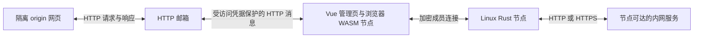

# Linux / browser 基础功能 demo

这是用户在 2026-10-21 明确授权的可运行 demo，跟踪于
[MIOPUNCH-109](http://192.168.4.22:2080/work/projects/aa58cd82-2afc-404b-a097-58ef553c7ca4/issues/d694bf68-f4da-427a-9158-aaed804d2184)。
采用已确认的 Vue 3 / TypeScript / Vite 与 Rust Native/WASM 分工，功能集中在一页。
本次交付 Linux 无界面宿主和浏览器接入；Tauri 安装版及完整客户端 PRD 的验收仍未完成。
后续 WebRTC 接通与跨网络实测跟踪于
[MIOPUNCH-110](http://192.168.4.22:2080/work/projects/aa58cd82-2afc-404b-a097-58ef553c7ca4/issues/3a9c20c1-8f4a-47d6-9d5f-e73d7f4a739e)。
用户 Edge/VPN 环境的后续建路诊断及重复探测修复见
[MIOPUNCH-111](http://192.168.4.22:2080/work/projects/aa58cd82-2afc-404b-a097-58ef553c7ca4/issues/3bfb70d1-8c0b-4c5b-9c9f-916c3a05bcdd)。

## 打开和使用

运行在 `r_proxy`，管理页面为 `http://192.168.4.14:18443`，隔离网页 origin
为 `http://192.168.4.14:18444`。使用交付的完整私密链接打开，点击“连接 Linux 节点”。
访问端需要能到达这台主机的 LAN/VPN 地址。没有创建公网隧道。

按用户要求另提供 `u22s` 入口：`http://172.16.3.11:18443`，隔离网页端口为
`18444`。使用交付的私密链接。`u22s` 上的用户服务 `miopunch-demo-forward`
经 SSH 隧道转发两个端口，同时适配配置和网页中的公开地址；WebSocket 也经此入口。
原 `r_proxy` 部署及其节点身份保持不变。隧道由当前开发主机的用户服务
`miopunch-demo-u22s-link` 保持运行，断线后自动重连；这两个用户服务本次使用临时
systemd 单元，尚未配置为跨主机重启自动启动。
映射后的浏览器完整检查同样 15 项通过，见
[u22s 检查结果](../docs/evidence/client-demo-2026-10-21/u22s-forward-result.json)及
[转发记录](../docs/evidence/client-demo-2026-10-21/u22s-forward.json)。

```sh
# 当前开发主机：停止或查看 SSH 映射
rtk proxy systemctl --user stop miopunch-demo-u22s-link
rtk proxy systemctl --user status miopunch-demo-u22s-link
# u22s：停止或查看两个入口端口
rtk proxy ssh u22s 'systemctl --user stop miopunch-demo-forward'
rtk proxy ssh u22s 'systemctl --user status miopunch-demo-forward'
```

先使用桌面浏览器。HTTP 宿主适配依赖 SharedWorker；已验证桌面 Chromium，
不支持该接口的浏览器会明确拒绝启动，不降级为服务器代管浏览器身份。

| 功能 | 本次可以尝试的操作 | 范围 |
| --- | --- | --- |
| 文件 | 上传到 Linux，保存完成后下载取回，校验 SHA-256 | 单文件 128 MiB；可重试相同分块；不是远程文件管理器 |
| 剪贴板 | 粘贴文本、发送到 Linux 文本缓冲、取回并复制 | 无桌面 Linux 不声明系统剪贴板；HTTP 下采用手动操作 |
| TCP / UDP | 创建 Linux 回环监听，使用内置回显服务或获准的内网目标，发送 socket 探测 | 浏览器不创建供本机其他应用使用的监听端口；双 Native 客户端接线另验 |
| 内网 Web | 输入节点可达的 HTTP(S) 内网地址，在页面内导航、提交表单、使用节点侧 Cookie | 响应最多 8 MiB，请求体 24 KiB；尚无目标 WebSocket 支持或任意站点兼容承诺 |
| 终端 | 创建多个工作区，输入命令，关闭视图后重新附着 | 真实 PTY / tmux，运行在独立容器内的 UID 1000 用户下，不是宿主管理 shell |

已获准的演示成员可以使用上述服务。完整的产品服务 ACL、来宾、逐项创世确认、
桌面及 Android 生命周期没有因这个 demo 而宣布完成。

## HTTP 与节点通信

HTTP 负责交付界面；节点通信使用已有 BrowserNetwork / NativeNetwork 的成员连接，
当前演示使用 WebSocket 中继引导和回退，并尝试 WebRTC 直连；界面显示成员连接
实际选择的路径，可刷新状态或重新探测直连。HTTP 页面交付与 WebRTC 数据传输
相互独立，页面的 HTTP 协议也不要求目标服务使用 HTTP。
已选中健康 RTC 路径时，重复探测复用现有通道；探测失败会刷新真实路径并继续使用
可用中继。节点状态中的 `rtcAttempt` 反映最近一次尝试，`browserRtc` 保留有限的
浏览器 ICE 状态、候选地址和统计，不包含 SDP 或 ICE 凭据。`effective: true` 仅表示
本次浏览器所需 RTC API 可用，不代表当前 VPN/NAT 路径可达。
连接区的“导出诊断日志”下载 JSON，包含时间戳、最近连接/探测错误、浏览器环境、
ICE 候选/状态和两端当前路径。未连接也能导出；状态采集不可用时，最多等待 2.5 秒后
导出已有记录。日志不包含访问凭据、邀请、完整 SDP、密钥或业务正文；候选 IP/端口
和节点标识会保留用于排查。不要刷新后才导出需要保留的本次错误记录。
Linux 的 `rtc-path-cleanup` / `rtc-candidate-cancelled` 日志保留失败或取消前的
真实 ICE 状态；用户可对照重试时间和 Native `stableId`，避免把通道等待当作通道已打开。

本 demo 不使用 Service Worker。隔离网页向 HTTP 邮箱提交请求，由管理页面的
浏览器节点经成员连接调用 Rust 提供端；提供端访问目标，响应经原路返回网页。
Python 邮箱不连接目标网站，也不持有浏览器节点密钥。



现有 SDK 的持久身份保护默认使用 Web Locks。HTTP 演示由固定 URL/名称的同源
SharedWorker 仲裁唯一的 Window 宿主，SDK 在该 Window 内运行以使用
`RTCPeerConnection`，多个页面附着同一节点。原有 SDK 及其默认存储实现没有修改；
HTTP 下仅对这一受仲裁的宿主提供 SDK 所需的单项锁适配，不是通用 Web Locks polyfill。
已验证两个页面复用身份、断开其中一个不影响另一个，以及重开后保留身份和成员资格。
若直接关闭拥有 SDK 的宿主页面，其他页面会停止访问，并提示关闭全部演示页面后重开；
本次不进行自动宿主接管，避免同一身份并行启动。更新后也请关闭全部旧版页面再打开。

网页 origin 没有管理 API 或节点对象。HTTP 邮箱要求访问凭据；来自网页的字段不能
选择 RPC 操作或改变管理侧选定的站点。目标限制在提供端解析到的内网/回环地址。

自动访问系统剪贴板等浏览器 API 仍受安全上下文和平台许可限制；HTTP 界面直接禁用
相应入口，提供手动粘贴和复制。文件哈希使用固定版本的便携 SHA-256 实现，
不依赖安全上下文中的 WebCrypto。

## 部署和运行

远端目录 `/home/js/miopunch-demo`，容器名 `miopunch-demo`。
容器使用独立运行镜像、只读程序目录、持久节点状态和终端工作区；没有挂载宿主
Docker socket 或用户主目录。节点私有状态仅 root 可读，终端进程先降为普通用户。
应用日志采用 `10m × 3` 轮转，容器重启策略为 `unless-stopped`。

```sh
rtk proxy ssh r_proxy 'docker stop miopunch-demo'
rtk proxy ssh r_proxy 'docker start miopunch-demo'
rtk proxy ssh r_proxy 'docker logs --tail 30 miopunch-demo'
rtk proxy ssh r_proxy 'docker exec miopunch-demo cat /state/entry-url'
```

最后一个命令向有权操作该宿主的使用者显示完整访问链接。不要把其结果放入仓库、
Plane 或公开日志。节点身份和已保存文件保留在 `state/`；终端工作区可跨浏览器断连
重新附着，但容器或 tmux 结束后不承诺恢复原进程。
每次宿主启动签发有效期七天、最多 32 次兑换的演示邀请；到期或用尽后可重启刷新。
邀请到期不结束已经保存的普通成员资格，访问链接中的交付凭据也保留。

## 本工作区的构建与验证

```sh
rtk proxy python3 demo/build.py
rtk proxy npm ci --ignore-scripts --prefix demo/client
rtk proxy npm run build --prefix demo/client
rtk proxy env DEMO_ENTRY_FILE=/path/to/private-entry-url node demo/check.mjs
```

Rust 构建通过共享 Cargo cache lease，保留锁文件、工具链、源输入和原始日志；
新增宿主通过 `pin_artifact.py` 固定到共享 `.artifacts/`。默认构建当前工具包的宿主和
中继，浏览器 SDK 默认使用 `.artifacts/tools/wasm-bindgen/0.2.129/wasm-bindgen`，
也可通过 `--wasm-bindgen` 指定工具；相同输入由 Cargo 复用。
输出位于 `.artifacts/runs/client-demo/`。也可通过 `--native-receipt`（本构建器的
`native.json`）和 `--browser-receipt`（浏览器构建器的 `build.json`）显式复用产物；
构建器验证完整输入和产物，缺失或变化时在 Cargo 前中止，不再依赖历史 `/tmp` 路径。

运行镜像见 [Dockerfile](runtime/Dockerfile)。程序打包包含构建后的 `client/`、
已验证的 `pkg/`、独立部署副本的两个原生程序，以及 `server.py`、`web_queue.py` 和
`terminal.py`；源码与产物来源记录在远端 `manifest.json`。只能转换独立部署副本，
不能修改共享 pin。

最终验证和截图见[运行证据](../docs/evidence/client-demo-2026-10-21/README.md)。
WebRTC 升级后的[跨网络证据](../docs/evidence/client-demo-2026-10-21/rtc/README.md)
记录原 `u22s:18443` 入口的 18 项检查、实际 ICE 路径，以及关闭中继后同一成员
连接继续读取文件的结果。`check.mjs` 设置 `DEMO_REQUIRE_RTC=1` 会严格要求两端
选中 RTC，并执行中继断开检查；`check-terminal.mjs` 与 `check-lifecycle.mjs`
分别复现历史终端输出问题、检查缺少 RTC API 和宿主丢失行为。
重复探测和 RTC 可用但 ICE 无路的[回归检查](check-path.mjs)分别使用
`DEMO_PATH_CASE=healthy` 和 `DEMO_PATH_CASE=unavailable`。
后者只在测试浏览器注入 relay-only ICE 且不配置 TURN，用于验证明确失败和中继保留，
不代表用户环境的已确认原因。用户反馈及诊断证据见
[后续诊断](../docs/evidence/client-demo-2026-10-21/rtc-diagnosis/README.md)。
