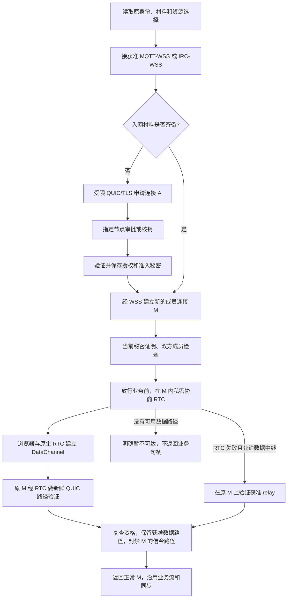

# 浏览器经 MQTT-WSS / IRC-WSS 引导 WebRTC：综合评估

优先级：**低**（用户于 2026-10-03 确认）。后续候选验证登记为 [MIOPUNCH-68](http://192.168.4.22:2080/work/projects/aa58cd82-2afc-404b-a097-58ef553c7ca4/issues/00215ab6-2318-48ef-8667-10f03c5957e5)，执行状态以 Plane 为准；当前保留评估依据，未启动 RTC 实施。

日期：2026-10-03。性质：候选方案评估。用户明确排除 IWA，并要求沿现有流程评估 MQTT-WSS / IRC-WSS 与 WebRTC 的接入位置和收益成本；本次未决定正式采用、默认公共服务、TURN 或移除现有 relay。三名研究子代理分别检查流程、库复用和收益，本文汇总其结果。

**建议：值得做一个范围小、使用真实浏览器与原生节点的原型；正式引入的复杂度为中高。** 它最明确的收益是让普通浏览器在网络条件允许时获得端点直连数据路径，避免业务必须经过 iroh 数据中继。现有浏览器已经能完成身份、入网、保存和同步，因此 RTC 的新增价值主要在数据路线。若目前通过获准 relay 已满足需求，尚无实测证明新增 RTC 的性能收益足以承担维护成本。[现有浏览器公共 relay 资格](2026-10-03-browser-official-public-relay.md)

## 接在现有流程的哪里

候选主流程如下。图中 A 是申请连接，M 是之后建立的成员连接；RTC 转换保持的是 M。

申请者尚无共享准入秘密，仍可先通过消息旁信道建立到邀请指定身份的受限 QUIC/TLS，完成申请和材料保存。之后的新 M 才证明当前秘密并检查成员。**RTC 协商接在 M 已通过准入检查、业务尚未放行的 `before_data_release` 阶段**；SDP、ICE 参数和尝试标识经这条端点私密会话交换，MQTT/IRC 服务端只传递原有消息，不需要理解 RTC 或 miopunch。[ADR 0005](../adr/0005-side-channel-control-bootstrap.md)、[准入与 hook 顺序](../../vendor/iroh/src/endpoint/connection.rs#L367)、[详细流程评估](2026-10-03-browser-webrtc-process-impact.md)

这个顺序避免新造一套节点身份或密码握手，也避免要求申请者先有 admission secret。它仍以浏览器 WSS 能完整承载真实受限 QUIC 握手和材料交付为前提；小消息 Pub/Sub 成功尚未证明该前提。若材料已保存而 RTC 数据路径失败，入网完成事实保留，业务报告暂不可达，无须重复批准或核销。[材料完成规则](2026-10-01-admission-completion-validation.md)

“同一连接”不跨越整个入网过程：A 与 M 不同，业务与 replica 也可使用不同 ALPN 的连接。要保留的是每条 M 自己的 QUIC 会话、exporter binding 和 stream 在 WSS→RTC/获准 relay 换路时的连续性。已放行 M 后续故障修复另走 Ordinary 路径打开入口；原 M 已终止时，重新建立的连接必须如实视为新会话。[现有连接维护资格](2026-10-02-connection-path-maintenance.md)

## 改动范围和真实难点

| 接入范围 | 当前缺口与需要适配的行为 | 相对复杂度 |
| --- | --- | --- |
| 浏览器 WSS 消息入口 | 当前 BrowserNetwork 的启动、online 和拨号依赖 relay；增加 WSS Adapter、订阅/注册就绪、目标投递路线、分片/限流和有界失败 | 中；MQTT 优先，IRC 单独资格化 |
| 双端 RTC 载体 | 浏览器调用原生 RTC API；native 引入兼容 RTC 栈；共享 QUIC datagram 报文桥、地址/session、poll/waker、背压与关闭 | 中高 |
| 成员路径协调与放行 | 能力版本包含 RTC，在 restricted hook 内驱动协商和原 M 的路径验证；两端允许 RTC 数据 ID，封禁 MQTT/IRC 信令 ID | 中高，首个原型的核心 |
| 选路、资源和失效清理 | 按实际 ICE pair 区分 direct/TURN；接入资源禁用、deadline、取消、成员移除、秘密世代和通道 retirement | 中高，持续维护的主要成本 |
| 业务与同步调用方 | 继续使用既有 Connection、stream、签名记录和保存规则；主要调整连接装配与资格检查 | 低到中，前提是载体 Interface 完整 |

以上为源码影响的相对判断，不是工时估算。陌生成员/名单过期恢复以及浏览器迁移的完整能力需要独立评估，不能隐入“增加 RTC transport”。[流程源码映射](2026-10-03-browser-webrtc-process-impact.md)、[库接入分层](2026-10-03-browser-webrtc-library-assessment.md)

最关键的四个具体接线问题：

1. **首次转换与活连接修复有不同入口。** restricted hook 内应由原 QUIC dialing side 用 `open_control_path` 开 RTC custom 路径；`open_data_transport_path` 要求已经 Ordinary，不能提前调用。RTC offerer、ICE 角色与 QUIC dialing side 分别处理。协商必须在 hook 内驱动，否则等待 `connect()` 返回后才启动 RTC，而 connect 又等待 hook，会产生死锁。[路径入口](../../vendor/iroh/src/endpoint.rs#L1133)
2. **当前 UDP commit 不能直接用于 RTC。** `commit_data_path` 要求已建立 IP 路径并关闭全部 custom 路径，会把 RTC 一并关闭。正常 M 可沿用最终 `authorize_candidates` 的明确 custom allowlist，但前置协调也必须通过 RTC 专用资格，不能再要求 IP-only commit 成功。browser gate 当前列表为空，两端需要配套接入；不能整体放开 custom。[实际 commit 与 authorize](../../vendor/iroh/src/socket/remote_map/remote_state.rs#L762)
3. **同一个公共设施有不同接入 URL。** native 的 `mqtt://host:1883` 与 browser 的 `wss://host:8084/mqtt` 不能分别 hash 后期待 service tag 相等。要在配置中明确逻辑设施与 TCP/WSS 入口的对应，保留现有 32 字节 route、topic/channel 与 MIO/MIR 封套，并遵守用户禁用。邀请的 contact 公钥本身不提供临时投递路线。[MQTT](../../src/mqtt_transport.rs#L40)、[IRC](../../src/irc_transport.rs#L110)、[邀请](../../src/manual_admission.rs#L32)
4. **预算与生命周期必须贯穿整次尝试。** 当前 contact 默认 10 秒，maintenance contact 为 2 秒，browser 外层为 12 秒，内部 bootstrap 上限 45 秒；内部上限不等于实际可等待时间。需要按调用方传递剩余预算、取消和退避，实测建路阶段耗时。RTC close 要退休地址、唤醒背压和 poll 等待者、解绑 JS 回调并回收端口/任务；迟到事件不能恢复已撤销或终止的路径。[预算与资格分析](2026-10-03-browser-webrtc-process-impact.md)

建议将这些行为集中在路径协调 Module 和两个 RTC Adapter 内。外部 Interface 沿用现有 Endpoint/Connection、当前资格、允许资源及取消/截止时间，输出“已验证数据路径、仍不可达或会话终止”。业务、审批和同步不必知道 SDP、ICE 或 JS 事件顺序；这能使复杂度集中在已有 seam，而不是分散到每个业务调用方。[载体 Interface](../../vendor/iroh/src/socket/transports/custom.rs)、[源码中的建议 Interface](2026-10-03-browser-webrtc-process-impact.md)

## 库能省掉哪些工作

| 范围 | 建议首先评估的复用 | 实际限制 |
| --- | --- | --- |
| 浏览器 | `web-sys` 调浏览器的 `RTCPeerConnection` / `RTCDataChannel` | 不在 WASM 内运行原生 RTC 网络后端；仍要写事件、队列、背压和关闭 Adapter |
| native | `webrtc` 0.21 的异步封装 | 可复用 ICE/DTLS/SCTP 与 socket/timer 驱动；仍要设置有限预算并映射当前资格和生命周期 |
| 共享报文桥 | `iroh-webrtc-transport` 0.1.0-alpha.2 的 frame/queue/pump 源码 | 旧 iroh/noq/wasm-bindgen 接口须移植；高层 facade 使用另一个 Endpoint/新 Connection，不能整套接入当前 same-M 模型 |
| 更深的 socket 控制 | `str0m` 0.24 的 Sans-I/O 实现 | 候选采集、STUN gathering、socket 收发/时间循环要自管；只有明确需要掌握物理 I/O 时才值得增加这层工作 |

这是按当前接入 seam 推导的候选顺序，未构建、未实测，不冻结版本或选型。固定发布包和当前工作树的差异、MIT 源码归属、native crypto 构建依赖及 FFI 备选均见[库评估](2026-10-03-browser-webrtc-library-assessment.md)。`webrtc` 的 runtime 抽象不会自动复用现有 iroh UDP socket；首次 browser↔native RTC 不以共用原物理 UDP socket为前提。[webrtc 固定 driver 源码](https://github.com/webrtc-rs/webrtc/blob/4be2e3d6f99787ac438d28f9f704d343b1aa1498/src/peer_connection/driver.rs#L434-L505)

## 收益是否值得这些成本

最明确的能力收益是：**普通浏览器可经允许的第三方 WSS 消息设施联系，再尝试端点直连数据；可行时数据不经过 iroh relay。** native↔native 已有 TCP/UDP 机制继续使用，无需一起改成 RTC。仍需要可用的联系设施，且某些网络下可能没有允许的数据路径；不必把 TURN 指定为新的必需资源。

| 用户目标 | 本评估的判断 |
| --- | --- |
| 普通浏览器可以入网、同步、使用成员业务 | 已有获准 relay 的真实基线；RTC 不是补齐这些行为的必要前提 |
| 浏览器在可直连网络中减少数据中继依赖 | RTC 补上当前能力缺口，值得限定范围验证 |
| 更低延迟、更高吞吐、更少 relay 流量 | 有可能，尚无本项目 RTC 数据；不能预报百分比或收益大小 |
| 任意 NAT 下始终可达，或手机页面长期后台常驻 | RTC 单独不能交付；数据回退和页面生命周期仍需各自处理 |

RTC 路线仍包含 `QUIC → DataChannel → SCTP → DTLS → ICE/UDP`。不排序、零重传 DataChannel 可以减少外层重复可靠重传，但仍保留 SCTP 拥塞控制，同时保留内层 QUIC 加密/控制。因此要测额外握手、双层加密与拥塞、复制、消息分片和队列对目标负载的影响；不能从“直连”直接推出“更快”。[RFC 8831 §5–6.1](https://www.rfc-editor.org/rfc/rfc8831.html#section-5)

库里的大 frame/缓冲默认值也不是项目预算：固定 alpha.2 源码最大 payload 为 65,535 字节，channel low/high 为 4/16 MiB，和 README 的 1200 描述不同。应明确单段 MTU、批量 GSO、双方 message size、单会话及总队列字节上限，再测内存和排队；本次不直接采用这些默认值。[固定源码核查](2026-10-03-browser-webrtc-library-assessment.md)

页面冻结、被回收或移动端切后台仍可能中断 RTC、WSS 和事件处理。刷新后可沿用保存的身份/材料，建立新会话；不能把旧 JS/RTC 对象或旧 QUIC session 当作仍存活，也不能把关闭页面等同于退出网络。[Chrome Page Lifecycle](https://developer.chrome.com/docs/web-platform/page-lifecycle-api)

名单过期恢复另有资格循环：当前 browser 拒绝本地不认识的成员，native 的受限历史交换又要求 IP 数据路径。若 RTC 只接普通 M hook，“先取历史才能认识对方”无法到达该 hook。后续需要明确受限历史专用 RTC 资格、验签保存后再正常 M；首个原型可限定已获准且互相已知的成员，但不能据此宣称浏览器恢复、轮换和迁移全面对齐。[恢复循环及平台差异](2026-10-03-browser-webrtc-process-impact.md)

## 建议用什么证据决定正式引入

最多四个有依赖的小切片，均为建议，本次没有运行。先用可控 MQTT-WSS，IRC-WSS 后续单独检查公网限流和完整交付；每片一个正常故事和一个关键失败，前片不成立便暂停扩大范围。

| 顺序 | 要回答的问题 | 最小可信证据 |
| --- | --- | --- |
| 1 | WSS 是否真的可复用当前安全引导？ | browser↔native 的真实 MIO/QUIC/TLS，首次无秘密申请、批准和材料保存；同邀请的另一身份不能冒充或读取双方交换 |
| 2 | 能否用 RTC 保留原 M 并获得真实直连？ | 分离的受控 NAT、TURN/数据 relay 禁用；selected ICE pair 与抓包证明 peer UDP；两端各自原 stable ID/exporter、新鲜路径 ACK、跨换路的控制 stream；放行后真实成员 PONG 与非空 LogSync 验证保存。业务与 replica 可分别建连 |
| 3 | 控制仍通而 RTC 数据断路时是否正确失败/回退？ | 实际 DROP RTC UDP、WSS 保留；业务不回灌 MQTT/IRC；只用获准且验证的数据回退或明确失败；释放附近取消/成员移除、迟到事件、通道关闭均不能复活旧路 |
| 4 | 目标设备上的收益是否抵得过开销？ | 与现有 WSS relay 在同一物理网络、peer 和应用负载下比较 setup/首回复、RTT/goodput、broker/relay/peer bytes、CPU/RSS、队列峰值和关闭清理；按交付对象补必要真实移动前台与 freeze/reopen |

正式引入应以第 1–3 片通过，第 4 片在目标场景展示可解释的收益和可接受开销为依据。若只能另建业务会话、目标网络不能 direct、资格/禁用被绕过或成本超出目标设备预算，先保留候选。不存在现成数字时，不编造成功率、速度、体积或开发天数；具体运行预算与产品性能目标在实施前明确。[验证切片与失败条件](2026-10-03-browser-webrtc-value-assessment.md)

## 本次证据与范围

本次读取工作树 HEAD 为 `c4974a0e4f2be3a7ff4b2474cb503279ad5b0253`，用户 WIP 保留。检查当前实现和固定上游发布源码，未实现 RTC、运行新 NAT/性能实验、提交或推送。本评估也未重跑已完成的 WSS 入口观测；后续低优先级候选验证已按用户要求登记到页首所链接的 Plane 任务。

已有入口回执：正常证书验证下，EMQX 与 HiveMQ 的浏览器 MQTT Pub/Sub、browser-WSS↔native-TCP1883 双向小消息通过；native 侧该回执未使用 TLS。Ergo testnet 仅 WSS 101 与 IRC 001 注册通过，未发送 PRIVMSG；这些均不证明完整 mio QUIC/RTC。公共服务只是观察对象，本次未决定作为生产默认。[MQTT 回执](../evidence/browser-wss-resources-2026-10-03/mqtt-browser-native.json)、[IRC 回执](../evidence/browser-wss-resources-2026-10-03/irc-browser-entry.json)

三份支撑报告：[现有流程影响](2026-10-03-browser-webrtc-process-impact.md)、[库复用与接入成本](2026-10-03-browser-webrtc-library-assessment.md)、[收益与验证建议](2026-10-03-browser-webrtc-value-assessment.md)。各报告分别标记源码事实、已有观察、推论与未验证项；本文中的采用顺序、相对复杂度与原型建议属于研究判断。
