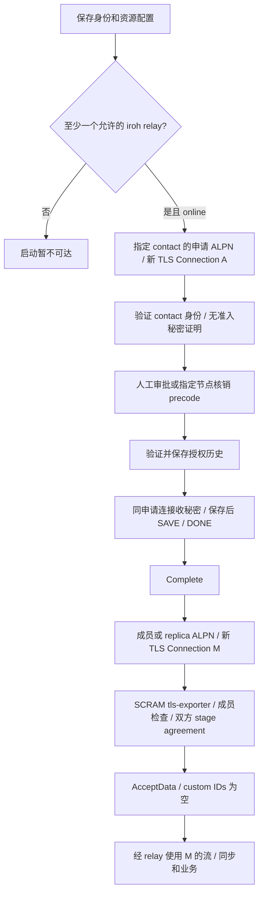
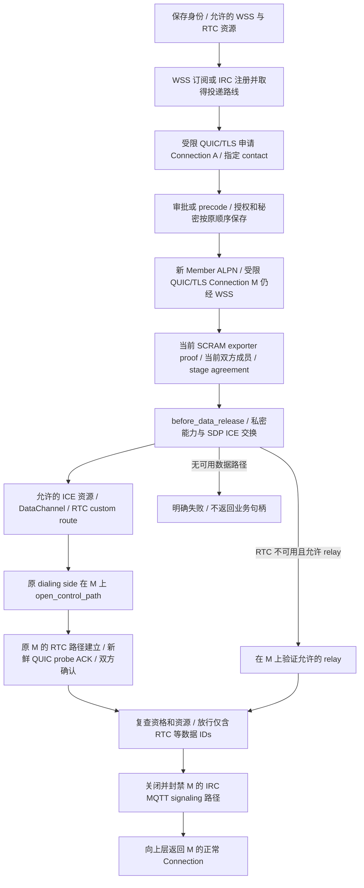

# 浏览器以 IRC-WSS / MQTT-WSS 引导 WebRTC：现有流程影响评估

日期：2026-10-03。性质：只读源码研究与候选适配评估，不是产品决策、实施计划或完成状态。未实施、实验、建票、提交或推送；未重跑已有入口测试或 NAT 矩阵。IWA 已被用户排除。本报告只讨论浏览器相关节点对使用 RTC，不建议替换原生节点之间的现有 TCP/UDP/NAT 实现。

**结论：流程可以沿用“旁信道受限 iroh 握手 → 资格检查 → 私密建路 → 放行原 Connection”的结构；代价是增加完整的 RTC Adapter 和若干现有资格、资源、恢复接线。对于希望浏览器摆脱数据 relay 必需依赖的目标，有实质能力收益，值得作为候选继续评估；对于现有 relay 浏览器已能满足的使用场景，尚无测量证明复杂度会换来性能收益。不能把“存在 CustomTransport seam”解释为接入已经可用。**

## 证据和约束

当前设计以 [CONTEXT](../../CONTEXT.md)、[产品方向](2026-09-27-product-mainline-draft.md)、[场景](2026-09-28-network-scenario-walkthrough.md)及 [ADR 0004](../adr/0004-network-admission-secret.md)、[0005](../adr/0005-side-channel-control-bootstrap.md)、[0006](../adr/0006-prepare-network-migration-before-switch.md)为准。README 中“尚无运行实现”的文字已落后于本次真实 Rust 源码；本评估没有据此忽略当前实现，也没有套用 archive 的旧流程。

证据标记：**源码事实**来自本地当前文件；**已有观察**来自本次收到并回读的测试回执；**推论**是据此推导的适配影响；**建议**不是已接受决定；**未验证**不表示已失败。

已有观察只证明入口：Chromium 153 正常证书校验下，EMQX `wss://broker.emqx.io:8084/mqtt`、HiveMQ `wss://broker.hivemq.com:8884/mqtt` 的 MQTT 订阅/发布，以及浏览器 WSS 与原生 TCP 1883 的双向消息通过；Mosquitto 8081 WSS 此次超时。Ergo testnet `wss://testnet.ergo.chat/webirc` 达到 HTTP 101 与 IRC 001，没有 JOIN/PRIVMSG，更没有完整 miopunch 握手。已有回执的持久副本分别为 [MQTT](../evidence/browser-wss-resources-2026-10-03/mqtt-browser-native.json)和 [IRC](../evidence/browser-wss-resources-2026-10-03/irc-browser-entry.json)。这些回执不证明公网 MIO 载体速率、受限 iroh、RTC 或同连接换路成立。

## 前后流程

源码事实：原生协议分类把 `admission-request/1`、`precode-request/1` 与 Member/Bootstrap 分开。申请连接不做 SCRAM；Member/Bootstrap 才做当前秘密的 SCRAM-SHA-256-PLUS，之后检查成员资格、双方 stage agreement。Member 返回 `AcceptData`；其他返回 restricted。[分类](../../src/admission_gate.rs#L23)、[握手](../../src/admission_gate.rs#L494)、[秘密与 TLS exporter 证明](../../src/admission_proof.rs#L25)

当前浏览器：

当前 native 有另一条已实现结构：Member Connection 从 MQTT/IRC/member signaling 起步时，在 `before_data_release` 交换 v2 能力，只含 TCP/UDP/relay，协调可用数据路径，之后由 fork 放行并关闭不合资格的 signaling custom 路径。[MemberPathBootstrap](../../src/message_bootstrap.rs#L184)、[native 装配](../../src/native_network.rs#L530)、[fork 顺序](../../vendor/iroh/src/endpoint/connection.rs#L367)

候选 after：

after 是建议，不是运行结果。**same Connection 的承诺范围是 M 在 WSS 与 RTC/允许 relay 之间换路**。申请 A 和 Member M 使用不同 ALPN、不同 TLS/QUIC 连接；当前 replica 与业务也可分别建连，恢复协调可另开受限连接。不能承诺整个入网、同步、业务、恢复只使用“一条 Connection”。[browser ALPN](../../browser-probe/src/network.rs#L20)、[申请](../../browser-probe/src/network.rs#L639)、[成员句柄](../../browser-probe/src/member_connection.rs#L50)、[replica 单次建连](../../browser-probe/src/replica.rs#L40)、[恢复另开连接](../../src/connection_recovery.rs#L122)

首次邀请和 precode 没有长期准入秘密；只包含网络锚点、指定 contact，precode 再附 bearer token。申请到指定身份的 iroh TLS 已能保护授权/秘密交付，不必先有 RTC，不必先有 admission secret。保存授权再收/保存秘密，再发 SAVE 的协议顺序可保持。旁信道此时承担受限交付，而不会因此取得一般业务承载资格。[邀请](../../src/manual_admission.rs#L32)、[受限协议检查](../../src/manual_admission.rs#L151)、[交付](../../src/manual_admission.rs#L334)、[完成](../../src/manual_admission.rs#L610)、[浏览器完成](../../browser-probe/src/network.rs#L520)

## 必须改变的 seam 映射

| 现有 Module / seam | 源码事实 | 候选最小改变和可复用行为 |
|---|---|---|
| 浏览器启动、contact 选择 | `relays.is_empty()` 立即失败；等待 `endpoint.online()`；`connect_target` 只枚举 relay。[启动](../../browser-probe/src/network.rs#L430)、[拨号](../../browser-probe/src/network.rs#L623) | 增加 WSS signaling Adapter、资源快照、明确 ready 和 bounded failure；无 relay 时允许有资格的 signaling 启动。不能只删除空列表检查，仍需替换 relay-only ready 和目标路线选择。 |
| WSS carrier 与资源 Interface | native MQTT 只认 `mqtt`，IRC 只认无选项 `irc`；两者 service tag 由 URL origin 派生，地址携带 tag+route。[MQTT](../../src/mqtt_transport.rs#L40)、[IRC](../../src/irc_transport.rs#L110)、[资源枚举](../../src/resources.rs#L168) | WSS 连接地址/path/subprotocol 与逻辑 messaging facility 分开；在受信配置中明确 native TCP 入口与浏览器 WSS 入口属于同一设施，才能兼容 route tag。不能直接把 `mqtt://host:1883` 与 `wss://host:8084/mqtt` 各自 hash 后期待互认。公网服务不需修改，双方客户端必须兼容相同 MIO 封装。 |
| 邀请与 transport hints | 邀请 96 字节只含锚点与 contact，transport hints 在连接配置另外提供。[邀请](../../src/manual_admission.rs#L32) | 保持邀请信任语义；另提供可用 WSS/临时 route hint 或受支持 discovery。身份公钥不自动等于随机投递路线。未知成员 discovery 与指定 contact 首次联系是不同资格流程。 |
| AdmissionGate / BrowserGate | native member signaling 例外依赖 `with_message_bootstrap`；RTC 数据 ID 不会自行获准；browser `AcceptData` 的 IDs 为空。[native carrier 资格](../../src/admission_gate.rs#L241)、[browser 放行](../../browser-probe/src/network.rs#L323) | 建连前注册 RTC 数据资格，两端配套安装放行前协调；保留未知 ALPN/未注册载体 fail closed、当前成员与秘密证明。不能把 MQTT/IRC ID 注册成业务数据。 |
| `MemberPathBootstrap::before_data_release` | 只有 member `AcceptData` 会调用；v2 wire 固定四字节，只协商 TCP/UDP/relay。[能力](../../src/message_bootstrap.rs#L17)、[hook](../../src/message_bootstrap.rs#L184) | 在现有路径协调 Module 中增加明确版本协商和 RTC 分支/Adapter；新旧端互操作选择已支持路径或明确失败。不能 append 第五字节让 v2 自动兼容。对 browser pairs 优先协商 RTC，不重写原生所有 NAT 逻辑。 |
| RTC `CustomTransport` Interface | factory、poll send/recv、地址 watcher、设施资格、shutdown、`Send+Sync`；browser 当前 Cargo 未自行打开 unstable custom feature，也没有 RTC DOM 适配。[Interface](../../vendor/iroh/src/socket/transports/custom.rs#L24)、[Cargo](../../browser-probe/Cargo.toml#L12) | 实现 wasm DOM 事件与 poll/waker 的桥接、native RTC 实现、datagram framing、队列/背压、通道失效和清理。feature 最终是否由 workspace 统一激活须以构建核查为准。标准 DataChannel 不是可直接替代这一 Interface 的对象。 |
| 受限路径打开与数据放行 | `open_control_path` 接受 custom，要求 Control，且仅原 dialing side；`open_data_transport_path` 要 Ordinary。[打开](../../vendor/iroh/src/endpoint.rs#L1220)、[状态检查](../../vendor/iroh/src/socket/remote_map/remote_state.rs#L395) | 首次 RTC 转换在 hook 内用前者，证明路径后由 `AcceptData` 最终放行；已放行后的修复用后者。RTC offerer/ICE 控制角色与 QUIC dialing side 分别管理。 |
| `ControlSession::commit_data_path` | 仅接受 established IP，限制到 IP，关闭所有 custom；RTC 是 custom。[session](../../src/control_session.rs#L269)、[fork commit](../../vendor/iroh/src/socket/remote_map/remote_state.rs#L762) | 不能用于 RTC。普通 Member hook 可利用现有 `authorize_candidates` 的 custom ID 允许列表保留 RTC、封禁 signaling；受限历史/恢复则需要明确的 scoped qualification 路径，不能借普通成员放行扩大权限。 |
| ResourceEndpoint 数据资格 / PathSelector | 数据 custom 只列 TCP/member-data；其他 custom 不享 direct 偏好。[资格](../../src/resources.rs#L620)、[偏好](../../src/path_selection.rs#L46) | RTC route 加入数据候选资格与资源撤销检查；实际 selected ICE pair 的 direct/relay 状态由 RTC Adapter 给出，TURN 不能伪装 direct。质量优先仍可比较获准的路径。 |
| connection recovery / maintenance | 修复有 exporter 绑定与新鲜 probe ACK；发现扩展主要是 MQTT+UDP，history commit 为 IP-only。[修复](../../src/connection_recovery.rs#L49)、[maintenance](../../src/network_maintenance.rs#L662)、[恢复](../../src/network_recovery.rs#L54) | 复用原连接绑定与 terminal 语义，补 RTC renegotiation/ICE restart 协调和资格；不能只把 RTC 地址塞进原 JSON 候选便期待通道已建立。保持原有预算，不另加无界 RTC 后台调度。 |

原生 IRC 实现每个 datagram 最多 2048 字节，128 字节分片，发送间隔 10ms，重组 TTL 3 秒；公网入口通过不表示这种速率适合公网 fakelag。需要客户端速率/消息长度/排队/超时 profile 的适配，不能要求第三方服务器放宽设置。[IRC 常量](../../src/irc_transport.rs#L31)、[发送节流](../../src/irc_transport.rs#L431) 首次授权可含较大管理历史，可能在低速 IRC 下触发现有时间/队列界限；这是流程可用性风险，不能只测小 SDP 或 IRC 001 就忽略。[申请历史上限](../../src/manual_admission.rs#L393)、[浏览器 timeout](../../browser-probe/src/network.rs#L23)

## 挂钩顺序、循环依赖与放行门槛

**正常新入网没有本质循环。**WSS 可先递送完整受限 QUIC/TLS，不依赖 RTC；申请 ALPN 不要求共享秘密；审批/核销交付秘密；再新建 Member Connection 做 SCRAM。随后在同一 M 的私密控制流中交换 SDP/ICE，RTC 才作为 M 的新报文载体。SDP/ICE 不必直接明文发布到 broker/channel，也无须自行引入另一套节点身份握手。前提是 WSS 的真实 MIO QUIC 握手、较大交付及受限阶段确实跑通；目前只观察到小消息入口。

**现成 hook 的顺序可支持候选结构，但有具体限制。**fork 先完成 `after_handshake`，再等待 `before_data_release`，最后 `authorize_candidates`；原 Connection 在 hook 内存在且仍是 Control，可发私密流并显式打开 custom path。若 Adapter 等待 `endpoint.connect()` 返回后才处理 SDP，connect 又在等 hook 完成，会出现实现自造死锁。协商驱动必须运行在 hook/RTC Adapter 内；两端明确 QUIC client 为 path opener，避免双方 accept-only。`open_data_transport_path` 在此阶段会直接拒绝，不能等待“自动转 Ordinary”。[顺序](../../vendor/iroh/src/endpoint/connection.rs#L367)、[custom path 条件](../../vendor/iroh/src/socket/remote_map/remote_state.rs#L537)

**外层预算可能先取消 RTC，内层长 timeout 不解决这个问题。**maintenance 保守与 active 的 contact timeout 都为 2 秒，普通 ResourceEndpoint 默认 10 秒，browser request/exchange 外层 12 秒；SCRAM 和 stage agreement 各有 5 秒界限，MemberPathBootstrap 整体上限 45 秒，已有原连接 repair 是 3 秒。[maintenance](../../src/network_maintenance.rs#L61)、[普通 contact](../../src/resources.rs#L535)、[browser](../../browser-probe/src/network.rs#L23)、[proof](../../src/admission_proof.rs#L30)、[bootstrap](../../src/message_bootstrap.rs#L279)、[repair](../../src/connection_recovery.rs#L15) 由于 endpoint.connect 包含 hook，WSS 握手、证明、私密协商、ICE 和 QUIC 验证实际共享较短的外层 deadline；未测量建路耗时，不能断言所有 RTC 必然超时，也不能把 45 秒视为实际可用时间。建议按具体 caller 明确整次尝试与阶段预算、取消清理，并在同一维护协调器内调整有界 profile，不新增全局 scheduler。RTC factory 可以预先 bind 空地址/事件桥，但 gathering、STUN/TURN 支出和 candidate 披露应在相应 proof、resource 和 attempt budget 检查后启动；所选上游 RTC 实现若在 bind 时自动开始探测，需要禁用/延迟这种行为再接入。首次 applicant 无秘密的申请流程不需提前进行 RTC gathering。

**名单过期恢复有真实的资格循环风险。**browser `permits` 要求目标已在本地成员集合，现有 native `MemberPathBootstrap` 又依赖双方当前成员。如果把 RTC 仅放在这一 Member hook 中，那么“先取得新成员历史再认识对方”无法到达 RTC。当前 native 是另外的 Bootstrap ALPN、已有秘密证明、限定历史交换，然后验签和保存对方成员状态；其数据条件却明确为 IP，浏览器无法照搬。[browser 资格](../../browser-probe/src/network.rs#L206)、[Bootstrap history 资格](../../src/member_bootstrap.rs#L46)、[未知对象历史验证](../../src/member_bootstrap.rs#L164)、[replica IP-only](../../src/offline_replica.rs#L105)

建议把恢复分成两级：已有当前秘密且未被已知撤销的端点可协商**受限历史专用** RTC 数据资格；提供者仍按自身已验证授权检查请求者；接收者验证签名历史、双方身份和网络锚点，保存后才能新建正常 Member 连接。此接线需明确 fork 的受限 custom allowlist/历史专用放行，普通 `AcceptData` 不能代替成员审批。与首次 applicant 无秘密的申请资格也要区分。维持当前 relay 恢复作为可选路径可以减少首个 RTC 范围，但不能据此宣称“浏览器全部恢复语义已适配”。

**最低可信数据门槛（建议）：**

1. 精确当前 M 的 SCRAM proof、双方现行成员、当前资源允许；协商报文绑定该连接和 RTC attempt generation，旧 SDP/ICE 不可跨连接重放。
2. 原 M 上出现预期 RTC custom 路径；DataChannel `open` 和 ICE `connected` 只能算下层准备好。
3. 在该路径启动新鲜 QUIC `Path::start_probe()`，看到原 M 的认证 ACK；双方交换成功确认并复查资格。路径 snapshot 的旧记录不等于今天可达，普通 stream echo 也可能仍走 WSS/relay。[现有恢复 ACK 做法](../../src/connection_recovery.rs#L199)
4. fork 的 per-connection packet policy 保留获准 RTC/data IDs，关闭 MQTT/IRC signaling IDs，再返回业务句柄；队列中旧包和远端新开路径也要被同一 policy 拦截。[放行实现](../../vendor/iroh/src/socket/remote_map/remote_state.rs#L823)
5. 验证两端本地 `stable_id` 各自前后不变、exporter/session binding 不变，并通过 RTC 新鲜 probe ACK。stable_id 仅是本机标识，两端不要求数值相等；同身份新建连接也不算成功续接。

RTC 底层关闭与 QUIC M 关闭不是同一事件。RTC 失败而 M 尚存活，可尝试允许的备用路径/修复；M 的 `close_reason` 一旦出现就是 terminal，任何新 RTC/新 TLS 连接都不得冒充旧 M。[terminal 区分](../../src/control_session.rs#L302)、[绑定原 M 修复](../../src/connection_recovery.rs#L92)

## 建议的深 Module Interface

建议把 RTC 复杂度留在一个深 Module 的 Implementation 中，外部 seam 沿用现有 endpoint transport、放行 hook 和维护预算，不引入全局新架构或重做原生 NAT 引擎。候选外部 Interface 是：在给定受限 Connection、当前资格凭据、允许资源快照、取消/截止时间下，**确保一条已验证的允许数据路径**，返回 opaque 路径 lease 与可观测结果；已放行 Connection 的 repair 接受原 exporter binding，返回“恢复/仍存活但不可达/terminal”。上层只知道 Connection、成员资格和有界失败，不接触 RTCPeerConnection、SDP、ICE、DTLS fingerprint、SCTP channel ID 或浏览器事件顺序。

两个 Adapter 分别填同一个实际 seam：native 现有 TCP/UDP/relay 协调，browser/native-RTC 的 RTC 协调。内部可有 WSS 与 RTC 状态机测试 seam，但不把每个 browser event 暴露给同步、审批、迁移、业务 Module。最小 Interface 仍必须表达资格、排序、取消和资源允许；只提供 `connect(peer)` 并隐藏这些前提，会制造错误的深度。

Implementation 的责任包括：offer/answer 与 candidate 顺序、trickle 结束、冲突/角色处理、attempt generation、DTLS fingerprint 所属私密交换、ICE/STUN/TURN 同意、DataChannel 参数、完整 datagram 收发、native/wasm poll 桥、发送队列背压、关闭与取消、同 M probe ACK、通道恢复及过期 route 回收。标准 RTC 是 SCTP/DTLS/ICE；不直接变成原始 UDP socket。可选 unordered + `maxRetransmits=0` 提供类似 UDP 的消息语义，减少外层重复可靠重传，但 SCTP 拥塞与额外封装仍存在；应先测互操作而非承诺性能。[RFC 8831 §5、§6.1](https://www.rfc-editor.org/rfc/rfc8831.html#section-6.1)

browser 的 `bufferedAmount`/low event、协商 `maxMessageSize`、`restartIce()` 是现成控制能力，但需要 Adapter 接入 poll/waker、队列上限和 generation 处理；它们不自行实现 miopunch 资格或 QUIC 原连接修复。[固定 W3C Recommendation 2025-03-13](https://www.w3.org/TR/2025/REC-webrtc-20250313/#rtcdatachannel)、[ICE restart](https://www.rfc-editor.org/rfc/rfc8445.html#section-9)

## 生命周期必须保持的行为

| 场景 | 可保留的语义 / 必须接线 |
|---|---|
| 入网中断 | 保持 request、授权、秘密分别持久保存，重试不能重复消费同一核销。RTC 新增不会改变保存成功标准；AUTH/SAVE/DONE 不得提前。[native 交付](../../src/manual_admission.rs#L610)、[browser commit](../../browser-probe/src/network.rs#L605) |
| 页面重开 / 网络变化 | 身份和授权沿用 IndexedDB，先获 Web Lock 再启动；重建 WSS 路线和 RTC session，重新证明。SDP、ICE 密码、channel 及 custom lease 是瞬态，不以恢复旧对象冒充旧 QUIC 连接。[browser storage](../../browser-probe/src/storage.js#L1) |
| 成员移除 | 当前已生效撤销必须取消 RTC 协商、封禁路径、关闭 M 和业务；不能仅停止 discovery。native gate 已关闭受影响 sessions；browser install 会关闭不再 permits 的成员连接，RTC Adapter 应随 Connection 生命周期清理底层。[native](../../src/admission_gate.rs#L282)、[browser](../../browser-probe/src/network.rs#L186) |
| 秘密轮换 | 保持创世授权、暂停入网/秘密交付、先持久保存再确认。native gate 使旧 proof 连接失效；RTC 不能跨秘密世代保留已失效的 M。browser 当前 install 主要依 permits 判断，不提供 native 的 generation proof 清除语义；若增加 browser 轮换，需要显式世代失效接线，不能假定已有 parity。[native rotation gate](../../src/admission_gate.rs#L315)、[browser proof 检查](../../browser-probe/src/network.rs#L305)、[ADR 0004](../adr/0004-network-admission-secret.md) |
| 活连接路径故障 | 原 M 存活才允许 RTC restart/replacement custom path；另开的受限恢复连接用 exporter binding 找原 M，必须新鲜 ACK。旧 RTC custom 地址退役后不能复用成已验证地址；replacement 需要新 lease/generation。当前恢复 3 秒界限是否适合 RTC 建路未验证。[恢复](../../src/connection_recovery.rs#L15)、[retired custom](../../vendor/iroh/src/socket/remote_map/remote_state.rs#L615) |
| 资源替换/禁用 | signaling、STUN observation、TURN data relay 分别检查。TURN 必须遵守数据中继允许，不因 RTC 开启而默认新增兜底；native relay 与 TURN 不同，不能复用同一 URL 当同协议服务器。保存明确选择，不让配置更新覆盖禁用。[资源用途](../../src/resources.rs#L13)、[资源检查](../../src/resources.rs#L209) |
| 迁移 | 目标网独立拿授权/秘密，验证真正成员通信并保存后才切换/退出源网。RTC ready、申请完成或 path probe 都不能代替目标完整业务/同步验证；保留节点身份不等于跨网续接旧业务。native migration 已用真实 LogSync complete 设置 validated，browser 尚无同等迁移 Module。[目标验证](../../src/network_migration.rs#L306)、[ADR 0006](../adr/0006-prepare-network-migration-before-switch.md) |
| 存储丢失/竞争 | 保留 strict transaction、比较替换、一次一页身份 lease；失败不得宣称秘密保存。持久配置可以存 facility aliases、用途同意、长期 contact identity；连接绑定、ICE credential、临时 route 不成为成员凭据。[事务](../../browser-probe/src/storage.js#L42) |

现有同步协议、签名验证、授权重放和保存结果无需因 RTC 重写；其承载前资格必须完整接入。所有候选上层 Interface 仍接受正常 iroh Connection 和既有记录，而不是 RTCDataChannel。[browser replica](../../browser-probe/src/replica.rs#L108)、[browser member handle](../../browser-probe/src/member_connection.rs#L16)

## 收益、成本和判断边界

有意义的收益是**浏览器获得候选直连数据路径，首个联系可以用普通第三方 WSS 消息设施，数据不再必然绕 iroh relay**。这与“无需普通用户自备 VPS、允许禁用官方资源”方向一致。只要存在支持所需消息能力的允许设施，就不要求 MQTT/IRC 服务端理解 SDP、QUIC 或 miopunch；服务端负责原有消息传递，两端客户端负责密文封装和适配。没有允许 signaling/可用直连/允许 relay 时，仍可能明确不可达。

不能宣称收益已经兑现：未验证完整 WSS iroh 受限握手、大历史交付、公网 IRC profile、RTC 与当前 fork 的 native/wasm 互操作、same-M ACK、跨网络 direct 成功率、弱网排队、电量、流量、延迟或吞吐。RTC 增加 DTLS/SCTP、ICE 维护和浏览器生命周期处理，可能换到 direct，也可能最终用 TURN；结果要按实际选中 pair 区分。没有测量，不给百分比或工时。

工作量粗分：

| 范围 | 相对复杂度 | 原因 |
|---|---|---|
| 只增 browser WSS messaging 入口 | 中 | WS 适配、facility alias、路线、真实 MIO 封装、fakelag 与启动/错误预算；入口回执只消除了部分协议可达性疑问。 |
| 普通 Member Connection WSS→RTC | 中高 | native/wasm RTC Adapter、hook 协商、版本兼容、custom 资格、同 M ACK、最终 packet gate；不能复用 IP-only commit。 |
| 已有浏览器业务/replica caller | 低到中 | 主要换连接装配和数据资格；身份、保存、LogSync 和 stream caller 可保持。低成本前提是 Adapter Interface 完整。 |
| 故障修复/资源禁用/撤销/轮换 | 中高 | generation、retired lease、绑定原 M、有界取消、TURN 用途、底层清理、browser 已有生命周期能力差异。 |
| 陌生成员/名单过期恢复与浏览器迁移完整 parity | 高且独立 | 当前 browser known-member-only 与 native IP-only history/恢复、filesystem migration 的具体限制；不能隐入“加一个 RTC transport”。 |

**本评估的建议：**如果目标明确包含浏览器直连，以及可禁用 iroh data relay 后仍借普通 WSS 设施联系，RTC 的收益值得承担候选适配成本；保留现有 native 数据实现与允许 relay fallback，限定到浏览器相关连接，成本可集中在深 Module 内。若目前只求浏览器正常加入和经允许 relay 使用，新增 RTC 不解决授权或持久化问题，可继续保留为候选。两种判断均不是采用决议。

真正冲突集中在具体实现条件：浏览器 relay-only 启动/拨号和空 custom allowlist，v2 capability 不含 RTC，IP-only commit 会关闭 RTC，ordinary-only path-open 不能用于放行前，以及 stale recovery 的已知成员门槛。ADR 的旁信道复用安全握手与当前秘密/成员语义不与候选 RTC 本身冲突。避免这些实现循环后，源码顺序没有显示正常新入网必须新增密码握手的本质障碍；但实际组合是否正确仍未验证。
