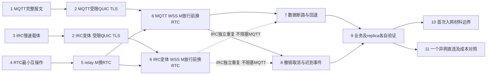

# 浏览器 WebRTC 重新规划：先证明载体，再证明原会话换路

日期：2026-10-03。**研究规划，未实现 RTC。** 本文修订此前[综合评估](2026-10-03-browser-webrtc-assessment.md)的推进顺序，不改变既有产品约束，也不表示正式采用 RTC、指定默认公共服务或领取实施票。UI 继续延后，IWA 排除，现有获准 relay 回退保留，TURN 不成为必需设施。

## 推荐结论

采用两条可独立定位问题的验证线，最后合并：

1. **载体线：MQTT-WSS 完整报文 → 真实受限 QUIC/TLS → 已知成员 WSS 引导。** IRC-WSS 单独验证慢速分片，不作为 MQTT 或 RTC 开始验证的阻塞条件。
2. **RTC 线：浏览器/native DataChannel 最小互操作 → 已有获准 relay 上的成员 M 换到 RTC → WSS 引导的 M 在放行前换到 RTC。** 先借已有可靠起点证明 RTC 与当前 fork 的组合，避免同时调试三个未成立前提。

首轮只承诺双方互相认识、材料已保存、当前秘密世代一致且仍获准的成员。随后分别补首次入网、陌生/过期名单恢复、轮换、迁移和页面生命周期；一个已知成员 demo 不代表这些能力完成。上述顺序是研究建议；任务状态仍以 [MIOPUNCH-68](http://192.168.4.22:2080/work/projects/aa58cd82-2afc-404b-a097-58ef553c7ca4/issues/00215ab6-2318-48ef-8667-10f03c5957e5)为准。本轮 live 回读为 Low、Backlog、未分配、无依赖边；未修改 Plane。

依据为 [CONTEXT](../../CONTEXT.md)、[产品方向](2026-09-27-product-mainline-draft.md)、[场景](2026-09-28-network-scenario-walkthrough.md)、[范围补充](2026-09-29-transport-and-ui-followup.md)、ADR [0004](../adr/0004-network-admission-secret.md)、[0005](../adr/0005-side-channel-control-bootstrap.md)、[0006](../adr/0006-prepare-network-migration-before-switch.md)，并 live 读取父规格 MIOPUNCH-14。旧 Go/OpenSpec 不作为本规划的实现门槛。

## 旧方案需要具体修改的地方

| 问题 | 本次调整及理由 |
| --- | --- |
| 第一步同时要求 WSS、首次申请、批准、材料持久化 | 拆开。先验证完整 datagram 和真实安全握手，再接已有材料交付；否则无法判断失败在哪层。 |
| 把 RTC 固定在 `before_data_release` 当成唯一入口 | 保留它作为 **WSS 起步 M** 的必要接线；先在已经正常放行的 relay M 上验证 RTC，用 Ordinary 路径入口。已有 relay 足够时不必让业务等待 RTC；后台改善仍受原维护预算控制。 |
| 假定 IRC 小消息成功足够支持 QUIC | 现有 128 字节分片、3 秒重组 TTL、500ms 出队期限、10ms 发片间隔属于实现参数，不是公网资格。1200 字节就需 10 片；先验证慢速完整报文，不提高公网发送强度来掩盖问题。 |
| 以 URL origin 代表同一设施 | native TCP/TLS 与 browser WSS URL 不同。配置需明确可信的逻辑设施及入口对应；IRC 还要表达投递 namespace/channel。别让入口别名绕过禁用，也不能靠相同 hostname 猜测服务互通。 |
| 有 custom allowlist 就等于 RTC 已获准 | allowlist 只识别载体类型；还需具体 peer、Connection、attempt 世代、当前资格、资源许可与新鲜路径验证。禁止整体放开 custom。 |
| 沿用 `commit_data_path` | 当前实现要求 IP 路径并关闭 custom，会关闭 RTC。M 放行使用明确 RTC 数据 ID；受限历史/申请将来需要独立受限路径资格，不能用 Member `AcceptData` 冒充。 |
| 45 秒 bootstrap timeout 被当成实际预算 | 外层 browser 12 秒、普通 contact 10 秒、maintenance 2 秒可能先取消。整次尝试只传一个 deadline，阶段读取剩余预算，不能叠加隐藏等待。 |
| RTC hook 覆盖所有恢复 | browser 的已知成员检查会挡住未知成员；native history 又是 IP-only。必须单独解决资格循环，不能先要求普通 M 成立才允许取得认识对方所需的历史。 |

这些判断来自当前 [IRC](../../src/irc_transport.rs)、[MQTT](../../src/mqtt_transport.rs)、[成员路径协调](../../src/message_bootstrap.rs)、[browser gate](../../browser-probe/src/network.rs)、[hook 顺序](../../vendor/iroh/src/endpoint/connection.rs)、[路径提交/放行](../../vendor/iroh/src/socket/remote_map/remote_state.rs)、[受限历史](../../src/member_bootstrap.rs)。本轮源码摘要与固定发布包身份见[源码回执](../evidence/browser-webrtc-replan-2026-10-03/source-receipt.json)。

## 公网事实与尚未成立的前提

| 对象 | 官方入口/已观察层级 | 使用边界及缺口 |
| --- | --- | --- |
| EMQX | 官方列 `broker.emqx.io` TCP1883、TLS8883、WSS8084 `/mqtt`；[已有回执](../evidence/browser-wss-resources-2026-10-03/mqtt-browser-native.json)证明 browser WSS 与 native 明文1883双向小消息 | 页面定位为原型/学习/测试。完整 MIO、native TLS、最大报文和实际速率预算尚未验证；不能把服务器软件默认值当公共集群承诺。 |
| HiveMQ | 官方 dashboard 列 TCP1883、TLS8883、WSS8884；已有回执的 `/mqtt` 双向小消息通过 | 官方明确公共 broker 不用于 Production、Dev、Staging、UAT，且无 uptime/性能保证。**研究建议：保留协议入口观察，不选它承载后续 MIO 集成验证。** |
| Ergo testnet | 官方列 WSS `/webirc`、8097，native TLS6697、明文6667 | 官方允许非滥用 Ergo/IRCv3 测试，并声明记录全部流量；非此用途应使用其他实例。**研究建议：本次只做协议互操作观察；完整 MIO 走自有/明确允许该用途的 IRC 实例。** |

一手入口：[EMQX](https://www.emqx.com/en/mqtt/public-mqtt5-broker)、[HiveMQ dashboard](https://www.mqtt-dashboard.com/)、[Ergo testnet](https://testnet.ergo.chat/)。这些公开实例不是生产默认设施决定。

本轮新增观察于 **2026-10-03 12:20:37–12:20:55 UTC**：Linux、Chromium 153.0.8010.12、正常证书验证，Ergo WSS101、`text.ircv3.net` 与 native TLS1.3/6697 注册成功；两个自有随机昵称间双向 PRIVMSG 小消息成功。未加入任何频道、创建账号或发送真实秘密。一个合成 1200 字节、MIR1 形状的消息按**主动选择的 600ms 间隔**分成 10 片，完整到达，首末到达跨度 5023ms、最大收到行 411 字节。[回执](../evidence/browser-webrtc-replan-2026-10-03/irc-entry-observation.json)

**推论：**若沿用当前从首片计时的 3 秒重组期限，这组到达时序不能完成重组。本轮没有调用真实 MIO 重组器，不能称作完整载体失败实验；600ms 也不是测出的服务强制限流。当前源码只收固定 channel 的消息，此次 direct-nick 私信观察不证明该 channel 路由已通过。观察页面由 Playwright 新建为 about:blank，尚不证明未来部署网页 Origin 的服务策略。Ergo 上游默认 fakelag 配置是 burst 5、之后每秒 2 条，属于软件默认值，**不是 testnet 当前配置的证据**。[官方配置](https://github.com/ergochat/ergo/blob/master/default.yaml)

## 每次尝试都要保留的安全与路径边界

申请连接 **A** 与成员连接 **M** 不同。A 到邀请指定身份的受限 TLS 不要求申请者先持有网络秘密；批准后验证并保存授权和秘密，才有入网完成事实。M 重新完成当前秘密证明、身份和成员检查。业务与 replica 若各自建立 M，分别记录、验证其会话，不把一条 M 的结果外推给另一条。

建议把 RTC adapter 与路径协调封装在现有连接 seam 内，输入当前 Connection、用途、资格世代、资源配置、取消信号及 deadline；返回已验证路径 lease 或明确失败。SDP、ICE、DTLS fingerprint 经已经认证的私密控制流交换，绑定 peer/network、当前 M 与 attempt generation；不直接在公开 broker 发布明文 SDP，不新增身份或密码握手。

WSS 起步 M 的 RTC 驱动必须在 hook 内运行，不能等 `connect()` 返回。首次路径由原 QUIC dialing side 调 `open_control_path`；已 Ordinary 的 M 使用 `open_data_transport_path`。初次建议由该 dialing side 发 offer，另端 answer；RTC offerer、ICE controlling、QUIC dialing side 是不同概念，协议显式约定，不靠两端各等事件碰巧运行。首轮一个 M 对应一个 RTC association，跨 M 池化暂不做。

DataChannel `open` 后，必须在**这条 M 的这条 RTC 路径**启动新鲜 QUIC probe 并取得认证 ACK；复查当前资格后才保留 RTC 数据路径、封禁 MQTT/IRC signaling ID。stable_id 在各端本地前后不变、exporter binding 相同、原 stream 连续，是同会话证据；两端 stable_id 不要求相等，不能用同身份重拨冒充。[现有 repair](../../src/connection_recovery.rs)

放行后，仍连着 WSS 不意味着原 M 可以退回 WSS 传业务。数据断路时沿现有单一维护协调器使用获准备用路径；需要旁信道修复时另开受限恢复连接并绑定原 M。原 M terminal 后只能明确失败，新会话另算。撤销、秘密世代失效、资源禁用、取消及迟到 ICE/onopen 事件都要退休 lease、关闭或拒绝路径；授权检查与放行/撤销不能只靠过时快照。

## 小步验证顺序

以下是研究依赖图和未来执行合同，**不是另一份任务账本或已执行结果**。尚不存在的 runner 标明“拟新增”，实施者先交付对应窄入口再运行；不自动创建一串 Plane 实施票。所有步骤沿用独立测试身份/存储、正常证书、公网低负载，失败只重跑受影响项。



图中第 3 步只阻塞 **IRC 版本**的第 2/6 步；MQTT 不等待它。第 4/5 步不依赖新 WSS 载体；现有获准 relay 是隔离 RTC 变量的起点，不是最终必需条件。

### 1. 首个实施增量：MQTT 完整 datagram

- **问题/前提：**browser WSS 与 native 是否能互送当前 MIO1 报文，而非仅几十字节 echo？复用已有入口回执，选择 EMQX 协议测试或自有正常证书 WSS broker；不新增 RTC。
- **最小改动/入口：**新增窄 browser WSS adapter 与可信 facility alias 配置；复用 native MIO1 编解码。拟新增 `rtk proxy python3 scripts/check_browser_paths.py --case mqtt-datagram --output /tmp/mio-rtc-s1`，只驱动这一个测试入口，不增加正式 UI。
- **正常故事：**两个独立端等待成功 CONNACK、对应 SUBACK 后，分别发送 1200、2048 字节合成 datagram，各方向逐字节匹配；同一 logical facility 的 native/WSS route 一致。
- **关键失败：**2049 字节本地拒绝，错误 service tag 不投递，订阅失败/断连不能发布 ready 地址。失败注入优先在自有实例，避免公网洪泛。
- **证据/通过：**时间、URL/逻辑设施、TLS/WSS101/subprotocol、CONNACK/SUBACK code、route generation、帧/字节/丢弃、队列峰值、ready/withdraw 时刻。仅四条正常数据消息；60秒外层上限，单阶段15秒，超时关闭两端并退订/断开。完整报文不过，停止该设施上的安全握手验证。

2026-10-03 后续授权实施的第 1 步自有设施资格及真实失败修复，见 [MQTT datagram 实施回执](2026-10-03-browser-mqtt-datagram.md)。本规划的其余步骤不因该结果自动视为完成。

### 2. WSS 上真实受限 QUIC/TLS

- **问题/前提：**第1步通过；只验证真实安全引导，不把批准和 RTC 放进同一步。
- **最小改动/入口：**在现有 browser/native 申请连接入口增加 carrier 选择、ready 与 route hints，解除 relay-only 启动假设；不能只删 `relays.is_empty()` 检查。拟新增 runner `--case wss-restricted-handshake`，沿用现有申请 ALPN，不造平行身份协议。
- **正常故事：**无网络秘密的申请者经 MQTT-WSS 认证邀请指定 contact，形成受限 A，完成一个现有申请控制交换，停在未批准状态。
- **关键失败：**同路由换成错误 contact 身份，TLS/预期身份拒绝；另一个同邀请身份不能被当作原申请者，且不能取得原交付结果。公网只用临时测试材料；注入/旁听验证在自有 broker。
- **证据/通过：**端点身份、ALPN、A stable_id、握手阶段时间/重传/载体总量、restricted 状态、无业务句柄；不记录秘密或 TLS key。整次诊断上限45秒，使用实际 caller 剩余 deadline，不能悄悄覆盖产品超时。失败定位到TLS/路由/报文预算后停止，不继续加 RTC。

2026-10-03 后续授权实施的 MQTT 版本已通过自有正常 TLS/WSS 设施资格，见 [受限 QUIC/TLS 实施回执](2026-10-03-browser-wss-restricted-handshake.md)。这不替代 IRC 变体、成员 M、RTC 或首次材料完成的后续验证。

2026-10-04 IRC 版本已独立实测该慢速 profile：正常 TLS/WSS 与指定 contact 身份认证后，现有 stage agreement 无法在预算内形成受限 A；12 秒 caller 同样不可用。见 [IRC 受限握手停止分支回执](2026-10-04-browser-irc-restricted-handshake.md)。这是第 2/6 步 IRC 路线的未资格化停止分支，不阻塞 MQTT/RTC，也不宣称第 2/6 步 IRC 已通过。

### 3. IRC 独立载体资格

- **问题/前提：**新公网私信观察已通过，但真实 channel/MIR1 仍未通过。自有或明确允许用途的实例，正常 WSS/TLS；使用独立随机测试 channel，绝不使用人类频道。
- **最小改动/入口：**配置化 namespace、发送 pacing、总尝试 deadline 和有界重组 profile；保持双方封套一致。拟新增 runner `--case irc-datagram`。现有 `scripts/check_irc_bootstrap.py` 可作为 native 回归参考，但其默认成功 fixture 关闭 fakelag，不能充当公网慢速证明。
- **正常故事：**两端 001/005、JOIN 完成及366就绪后，按声明的保守 pacing 双向重组一个1200字节真实MIR1 datagram；记录首末片跨度。之后才尝试第2步的 IRC 版本。
- **关键失败：**缺一片、重复冲突片或取消时不得交付半包，不得产生无界 pending；超过整次预算明确不可用。PING/PONG不能因长片串发送被饥饿。
- **证据/通过：**完整行长度、server prefix、ISUPPORT、片序/间隔/重组年龄、expired/rejected/pending、queue age、关闭回执；测试最长60秒，至多两组完整报文及一组本地故障，清理自有channel和连接。若握手预算无法容纳，停止宣称此 profile 支持 QUIC；保留 MQTT 路线，不把提高服务负载作为修复。

2026-10-04 后续授权实施的第 3 步已通过自有正常 TLS/WSS 的慢速完整 MIR1 载体验证，见 [IRC datagram 实施回执](2026-10-04-browser-irc-datagram.md)。这不证明该 profile 能在实际 caller 预算内完成 IRC 受限 QUIC/TLS，也不替代第 2/6 步的 IRC 独立变体。

### 4. RTC 最小互操作（仍不是 MIO 路径）

- **问题/前提：**浏览器 RTC API 与一个固定 native Rust 库是否匹配所需消息语义和关闭行为？与 WSS 线独立。
- **最小改动/入口：**只添加测试用 native RTC endpoint 和 browser adapter，先通过已有受保护 relay M 递送协商；拟新增 runner `--case rtc-channel`。保留当前 QUIC 上层，测试 payload 明确为合成数据。
- **正常故事：**同 LAN/no TURN，一条 unordered、`maxRetransmits=0` channel，双向1200字节消息；读取实际 negotiated 参数、maxMessageSize 与 selected pair。
- **关键失败：**发送队列达到明确上限后停止接收更多发送，close/cancel 唤醒等待者，迟到 onopen 不复活。此步不要求 NAT 成功率矩阵。
- **证据/通过：**编译版本/features、ICE/DTLS/SCTP状态、channel参数、队列/复制次数、事件与socket清理；20秒建路/60秒总测试上限，失败关闭自有RTC对象/任务。channel不过，不接 QUIC bridge。

### 5. 原 relay M 换到 RTC

- **问题/前提：**第4步通过，双方已获准且互相已知，现有 relay M 已正常建立。
- **最小改动/入口：**datagram bridge、RTC route lease、Ordinary custom path入口及精确data allowlist；拟新增 runner `--case relay-member-rtc`。不改材料交付、不强行走 IP-only commit。
- **正常故事：**原 M 开一个测试 stream，协商 RTC，原 dialing side 打开 RTC path并取得新鲜probe ACK，停用该 M 的relay路径后原stream继续回应。
- **关键失败：**DataChannel open但丢弃其QUIC数据，probe不成功就不能报告换路；旧relay获准时原M可继续使用它。
- **证据/通过：**两端各自stable_id/binding比较布尔结果、path id、probe发起/ACK时刻、RTC与relay字节差分、原stream序号；45秒尝试上限并服从caller deadline。不能证明same-M则停止，不用另建连接掩盖。

### 6. WSS 起步 M 的放行前转换

- **问题/前提：**第2、5步通过，首轮仍限已知且获准成员。
- **最小改动/入口：**能力协议显式升级版本、双方hook驱动、Control路径入口、最终policy保留RTC而封禁signaling；拟新增 runner `--case wss-member-rtc`。v2四字节能力不能靠直接追加字节兼容。
- **正常故事：**仅MQTT-WSS取得M，当前秘密证明和双方成员检查后私密协商RTC；原M新鲜路径ACK及双方确认后才返回正常句柄。
- **关键失败：**旧端无RTC能力且没有共同获准data path，明确不可达；两端不得互等connect返回或把MQTT当data fallback。
- **证据/通过：**hook阶段、协议版本/角色、M绑定、资格世代、最终custom allowlist、放行时刻、signal/data字节；45秒诊断上限/实际剩余预算。失败清理attempt，不清除已保存成员材料。IRC版本独立重复此步，不能复用MQTT结果冒称通过。

### 7. 断 RTC 数据，保留信令入口

- **问题/前提：**第6步通过。
- **最小改动/入口：**复用维护/repair入口，加入RTC失败通知和retirement；拟新增 runner `--case rtc-data-cut`。故障只作用于自有实验端点或隔离netns，不能修改宿主全局规则。
- **正常故事：**实际DROP选中RTC数据流，获准relay存在时验证并恢复原M；没有允许fallback时报告原M仍活但不可达或最终terminal。
- **关键失败：**禁止relay时不得暗启TURN/其他服务，业务不能回灌MQTT/IRC；原M已close时新RTC不得冒充修复。
- **证据/通过：**精确DROP规则、pcap/计数、业务序号、signal bytes、repair binding比较、terminal时间；60秒外层、恢复遵从caller预算，finally撤销自有规则/进程。数据用途隔离不成立即停止后续能力宣传。

### 8. 资格变化与迟到事件

- **问题/前提：**第6步通过；不是要求先实现完整browser轮换产品。
- **最小改动/入口：**RTC attempt跟随现有撤销/秘密世代/取消与资源失效；拟新增 runner `--case rtc-invalidation`，每次只改变一种条件。
- **正常故事：**取消一个正在建路的attempt，随后新attempt可成功且旧地址已退休。
- **关键失败：**在路径ACK与放行之间应用成员移除或秘密世代切换，再注入旧onopen/candidate；不得返回业务句柄、发包或复活旧M。资源禁用用同样边界单独检查。
- **证据/通过：**authorization/resource/secret revision、attempt id、事件时序、retired route、释放前后活动socket/task/队列；每例60秒，结束后待发/重组为零。这里若只能靠一次快照检查，不能进入下一步。

### 9. 真实成员业务和非空 replica

- **问题/前提：**第7、8步通过；证明路径接线没有只服务测试echo。
- **最小改动/入口：**沿用成员消息与p2panda LogSync入口，拟新增 runner `--case rtc-member-replica`；不改同步协议。
- **正常故事：**真实成员PONG，随后非空原作者记录经replica M同步、验签、保存，重开存储后读回；每条M分别记录same-session及RTC路径证据。
- **关键失败：**同步在保存前中断不能报complete；业务M成功不能替replica M取得资格。
- **证据/通过：**每ALPN连接与路径、原记录hash/正文保存回执、同步范围及来源、重开结果；120秒总测试上限，仅自有小记录，结束关闭两条M及其RTC。无须重跑未改动慢NAT矩阵。

### 10. 首次入网材料完成边界

- **问题/前提：**第2、9步通过；首次入网单独加入，不再压进第一步。
- **最小改动/入口：**复用现有申请/交付/IndexedDB持久化，拟新增 runner `--case wss-admission-materials`。
- **正常故事：**无秘密申请者A经WSS获批，授权与秘密验证保存后Complete；随后新建M并走RTC。A和M分别报告。
- **关键失败：**材料保存后RTC失败仍保留Complete；保存前中断只能PendingMaterials，原交付节点续传不重审批/重复扣码。两个持同邀请身份互不冒充。
- **证据/通过：**申请identity、批准次数、保存/ACK顺序、持久化阶段、A/M区分；小历史先测，120秒测试上限。若大历史在IRC预算不成立，停止该carrier宣称支持该交付规模；不无界增时或丢掉历史验证依据。

### 11. 一个真实异网直连和成本对照

- **问题/前提：**第9步通过；先分离网络的一个可行场景，再选实际目标设备/运营商，不把全NAT矩阵变成早期门槛。
- **最小改动/入口：**同一runner加拓扑/采集配置，拟新增 `--case rtc-cross-network`；对照既有获准relay，native-native TCP/UDP不改。
- **正常故事：**TURN及数据relay在此**测试条件**下禁用，selected pair两端均非relay，抓包与端点地址对应，RTC承载真实成员数据；之后在相同条件比较relay与RTC。
- **关键失败：**UDP不可达时如实无direct，不能用TURN结果标direct；性能更差也如实记录，不为了结果改拥塞算法。
- **证据/通过：**selectedCandidatePairId、local/remote candidate type/protocol/address、pair bytes、peer pcap、QUIC path/probe/业务结果；setup/首回复/RTT/goodput、CPU/RSS、队列峰值、relay与peer字节。一次场景120秒，至多三次有间隔重复，清理自有拓扑。通过只证明该环境；不编公网成功率或性能收益。

## 首步可运行入口与测试预算

本轮已实际运行、现在可复现的协议观察入口为：

```sh
rtk proxy node docs/evidence/browser-webrtc-replan-2026-10-03/irc-entry-probe.mjs
```

它会重写同目录观察回执；需要保留本轮证据时先复制该目录到新的具名目录并调整导入路径，或先改runner支持独立输出再重跑。当前证据已足够，不建议为取得“更多成功次数”立即重跑公网。脚本55秒保护期限，只用两个自有昵称，关闭浏览器与TLS socket；sandbox内Chromium启动曾因系统socket限制失败，随后窄命令自动审批后完成，失败不算服务不可达。

**下一次实施首步推荐第1步**：完整MQTT报文与ready/route撤回，不实现RTC，不做正式UI。上文 `check_browser_paths.py` 是拟新增单一测试runner，并非当前存在的命令；首个增量交付它的 `mqtt-datagram` case及最少adapter，再以一个正常/一个失败故事评估是否进入第2步。

现有正常browser relay故事可从 `rtk proxy python3 scripts/check_browser_public_relay.py --output /tmp/mio-rtc-baseline` 复现，但本轮未重跑；已存[资格证据](2026-10-03-browser-official-public-relay.md)。只有相关接线改动时才运行受影响基线，不把全部旧suite/慢NAT变成文档研究门槛。

上述秒数/报文数是**建议实验保护上限，不是产品SLA或已验证最佳参数**。所有未来runner需外层进程组deadline与finally清理；只撤销自己的容器、网络规则、临时profile/监听端口，不停止其他工作资源。总预算、阶段耗时和取消原因必须写回执；不能只记录成功耗时。公网不跑吞吐/洪泛/极限重组压力，压力及故障在自有资源运行。

## 库、报文与资源适配的建议

本轮重新查看官方发布页面并下载固定发布包，未编译或运行候选库：`webrtc 0.21.0`、`str0m 0.24.0`、`iroh-webrtc-transport 0.1.0-alpha.2`，版本/包hash/VCS见源码回执。

- **首选验证候选：**browser用原生RTC API经web-sys；native先试webrtc 0.21.0。其async driver拥有socket/timer，减少首个互操作实验的驱动工作。发布源码显示自行bind UDP/TCP，runtime trait不代表直接共用iroh UDP socket；初版独立socket是合理实验选择。[官方发布](https://docs.rs/crate/webrtc/0.21.0)、[driver源码](https://github.com/webrtc-rs/webrtc/blob/4be2e3d6f99787ac438d28f9f704d343b1aa1498/src/peer_connection/driver.rs)
- **必须覆盖默认值：**webrtc发送缓冲默认不设限，显式使用`with_data_channel_send_buffer_limit`；自己的总队列仍单独约束。str0m提供Sans-I/O，对socket控制更直接，但要求调用方完整驱动输入、输出、超时与候选获取；只有前者无法满足实际约束才转向它，不同时维护两套正式adapter。[webrtc buffer](https://github.com/webrtc-rs/webrtc/blob/4be2e3d6f99787ac438d28f9f704d343b1aa1498/src/peer_connection/mod.rs)、[str0m发布](https://docs.rs/crate/str0m/0.24.0)
- **只借鉴局部：**iroh-webrtc-transport的frame/pump可参考，不能搬入另建Endpoint/Connection的高层facade。固定alpha.2 frame最大payload是65535，header30字节，channel默认low/high为4/16MiB，并默认配置公共STUN；都不是本项目认可预算或允许资源。[发布源码](https://docs.rs/crate/iroh-webrtc-transport/0.1.0-alpha.2/source/)

建议RTC首轮一条unordered、maxRetransmits=0 channel，消息边界对应单个QUIC datagram，先不开GSO聚合。仅unordered仍然可以可靠重传，不能混淆。QUIC提供可靠性，外层SCTP仍有拥塞控制、分片和DTLS成本，不能称作原始UDP，也不能据直连推导更快。[RFC8831](https://www.rfc-editor.org/rfc/rfc8831.html)、[DCEP](https://www.rfc-editor.org/rfc/rfc8832.html)

从1200字节起步并明确最大datagram；不能为适配IRC把QUIC Initial缩到1200以下。MQTT现有MIO1增加20字节，当前53字节topic、MQTT3.1.1 QoS0下，1200/2048字节datagram对应MQTT完整packet约1278/2126字节，尚未含WebSocket/TLS开销。IRC同样两档分别需10/16片；600ms主动间隔下仅片间跨度约5.4/9秒，尚未包含完整TLS握手、往返和历史交付。应测实际wire预算再决定profile，不把协议理论最大值当服务器额度。[QUIC尺寸](https://www.rfc-editor.org/rfc/rfc9000.html#section-14.1)、[MQTT规范](https://docs.oasis-open.org/mqtt/mqtt/v3.1.1/os/mqtt-v3.1.1-os.html)

RTC发送前取双方协商maxMessageSize，包含自有frame header；浏览器`bufferedAmount`/low event接入poll/waker，单一发送pump避免并发超发，队列满不能谎报已发送或忙循环。建议初始实验adapter TX/RX各64KiB、channel发送64KiB、单peer应用侧总预算256KiB，再按测量调整；这不是浏览器/库底层全部内存硬上限。必须计入WASM↔JS复制、Bytes/Vec复制、SCTP内部缓冲和候选队列，关闭唤醒所有等待者并解绑JS回调。[WebRTC API](https://www.w3.org/TR/webrtc/)

资源模型必须分别处理WSS signaling、STUN observation、TURN data relay；当前CustomTransport单个`resource()`描述不足以自动管理RTC内部多个设施。首轮显式空TURN配置、只传获准STUN，不继承第三方默认服务器。仅关闭本地TURN还不证明没有remote relay candidate；direct-only实验同时约束双端配置与候选，并核对选中pair。ICE restart换pair后重新分类、检查资源并退休旧lease。selected pair为relay就是中继，iroh relay也不能当TURN URL使用。[统计标准](https://www.w3.org/TR/webrtc-stats/)、[custom seam](../../vendor/iroh/src/socket/transports/custom.rs)

## 后续能力边界与停止分支

| 后续故事 | 进入条件与不可省略的验证 |
| --- | --- |
| 陌生/过期名单恢复 | 已知成员路径稳定后单独设计受限history RTC资格：已有当前秘密、身份认证、已知撤销拒绝；历史验签保存后再建普通M。不能以“未知成员不在本地名单”为最终产品限制，也不能提前放开普通同步。 |
| 首次申请的大历史交付 | 先测WSS A的真实预算；若低速IRC不成立，研究在已认证且用途仍受限的A上取得RTC路径传获准材料，或使用已有获准relay。路径升级不授予成员资格，保存完才Complete；这是后续候选，当前不默认实现。 |
| 秘密轮换 | 第8步须保证旧世代RTC/M失效；完整browser轮换另测持久确认、暂停新入网/交付、重启恢复，不因已有RTC维持旧proof。 |
| freeze/reopen | 页面freeze不是长期常驻保证；恢复仍先校验原M活性。页面回收/reopen使用已保存身份和材料建立新会话，旧SDP/ICE/lease不持久化为可用凭据；关闭不自动退出。 |
| 迁移 | 目标网独立授权、材料保存、真实目标成员通信验证后才切换；RTC open/probe不能替代目标业务验证，旧业务不跨网冒充same-M。 |
| 多浏览器/移动设备/性能 | 已有Linux Chromium前台成功后才按目标交付设备补一个真实环境；只扩大受影响的矩阵，未改动已验证慢NAT可跳过。 |

若MQTT完整报文或受限TLS不成立，停止该载体集成，先定位帧/预算/路由；RTC可继续以现有relay隔离验证。若RTC只能另建M，停止same-session方案的采用判断，不能把它改称原会话续接。若IRC必须无界等待或超过可接受设施用途才成立，保留为未资格化路线，不阻塞其他已获准路径。若RTC实测只增加成本而无目标场景收益，保留候选，不移除现有relay。

## 真正需要用户决定的少量事项

当前研究结论和首步无需再确认例行库/队列/runner选择。进入正式能力范围或成本比较时才需要：

1. 首个可交付RTC范围是否接受先限“互相已知且当前获准成员”，并明确后续补全恢复/首次入网等故事？本文推荐接受这种阶段范围，不能把它变成永久删减。
2. 成本对照首先代表哪种真实使用场景/设备，以及用户认为值得新增维护成本的具体收益？在得到目标前只报告测量，不编成功率、延迟或吞吐门槛。

默认公共设施、TURN采用和正式native库选型等决定留到证据出现后，不在本轮先冻结。当前无需用户提供秘密、部署VPS或批准大规模实验。

## 本轮交付与核查范围

实际工作仅为当前源码/规范/官方发布核查、Plane只读回读，以及上述一次有界IRC协议观察；已有MQTT和browser relay结果复用原回执。未实现RTC、未运行新NAT/吞吐实验、未构建候选库、未改UI/产品源码、未提交或推送。证据脚本与回执保存在独立目录，不复制旧证据；用户WIP保持原状。

文档本地链接、证据JSON解析、probe JavaScript语法与`git diff --check`通过。观察后仅补强probe的TLS等待取消及显式browser等待超时，未再次连接公网；保存回执属于前述实际运行，不声称补强后的失败分支已经实测。
