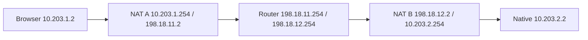

# Browser RTC：分离网络、实际 NAT 包与有限成本对照

这是 [WebRTC 重排第 11 步](2026-10-03-browser-webrtc-replan.md) 的隔离实现与受控证据。原成员的真实 PONG、另一条独立 replica M 的原作者记录验签/保存/同 origin 重开，以及禁止 peer UDP 的真实失败，均在五个独立 kernel 网络 namespace 中取得。它证明本次显式 SNAT/UDP-DNAT 场景可行；没有物理公网、移动网络、NAT 类型、成功率或性能收益结论。正式主线验收由 root 完成，仍须与第 10 步语义合并并在合并源上重新取得 10/9/11 回执。

可复现入口如下，输出目录必须尚不存在；构建在每场景 120 秒之外单独计时。执行需要已有受控 Docker 镜像、Node/Playwright/Chromium、私有 NSS 与 wasm-bindgen 工具。

```sh
rtk proxy python3 scripts/check_browser_paths.py \
  --case rtc-cross-network \
  --target-dir /tmp/miopunch-rtc-s11-target-20261004 \
  --output /tmp/mio-rtc-s11-new-controlled-run
```

SDK/transport 增量是不可变的显式 `RtcIceProfile`：最多两个数字 IPv4 STUN observer、八个候选地址；空 profile 保留原来的无 ICE server 行为。没有 TURN、凭据或隐式公共 DNS/server。这里仅允许实际收集到的 WAN 地址进入候选行，原始 private base 仍可出现在统计与 related-address 字段，不能因此声称不存在私网地址。native fixture 将标准 `stun:IP:port` 映射到既有 Observation 资源身份 `stun://IP:port/`；disabled 的两种拼写/默认端口/路径别名均不能绕过用户选择。profile 不新增成员授权、ALPN、同步 wire 或拥塞算法。

本轮拓扑是四个新建 internal bridge、五个独立 namespace。应用以 UID1000、有效 capability 为空运行；五个自有 namespace 的 root 配置进程持有 NET_ADMIN，只有 NAT/router 额外持有 NET_RAW 用于包记录。没有 host network、特权容器、daemon socket、全局防火墙/CA/HOME 改动。移除 Docker 默认 next hop，远端 private LAN 与 IPv6 不可达；只放行自有 STUN/MQTT-WSS 服务及对应 case 明确允许的 relay。NAT 是显式宽松 SNAT/inbound UDP-DNAT 模型，没有测得 EIM/EIF 或公网打洞能力。



router 自有服务地址为 `198.18.0.10`。启动前验证 subnet 与现有 Docker 网络不重叠；备用范围另记在实际 topology 回执。证书仅用于本轮私有 trust，实际正常 TLS/WSS 验证，SAN 为 localhost、mio-mqtt.test、mio-relay.test，没有证书绕过参数。

准备阶段通过既有获准 relay 保存材料、由真实 native 签署一个 36B 正文的 Add 记录，然后关闭 native store 与浏览器。direct、blocked、relay 使用同一个关闭后私有 seed 的新副本，原 author/header/body/browser identity、TLS、编译产物、CC、拓扑相同，seed 文件 hash 在各场景之后不变。材料准备不是第 10 步首次无材料 WSS 入网的替代证据。direct 不启动 relay 服务，也不允许其 TCP8443；relay 使用既有允许 relay，不创建 RTC。WSS 上的受限 bootstrap/私有协商与成员数据 path 分开统计。

最终正常运行的 prepare/direct/blocked/relay 各自包含 fixture、工作和实际清理：16.799/21.124/26.972/17.051 秒；工作上限105、清理预留15，总上限120。原始证据见 [receipt](../evidence/browser-rtc-cross-network-2026-10-04/receipt.json) 与 [说明](../evidence/browser-rtc-cross-network-2026-10-04/README.md)。正常回执的76个源 before==after、五个编译产物集合不变、实际执行子集逐 case 记录。之后仅有四个 teardown/control helper 的 SIGTERM/审查修复及一处 source registry 元数据增量；不会把正常回执冒充为修改后所有分支的完整运行。

BUSINESS 与 REPLICA 各自使用原 M、自己的 ALPN/RTC path ID，双方均有初次 authenticated probe ACK 与更新 watermark 的最终 release ACK；retention 前该 path 的 STREAM/DATAGRAM 均为零，stable ID/exporter-binding 比较不变，授权持续当前。真实 PONG/五次 PING RTT、独立非空 LogSync、完整原作者 header/body 相等、durable Receipt、IndexedDB 保存与同 origin 重开都由现有 SDK 入口取得。replica 保存使 source revision 前进，仍合法的原 M 资格不被误撤销。

native 实际 selected local candidate 为 `10.203.2.2:port` 的 host、remote 为 browser WAN srflx；browser 为 WAN srflx↔srflx。两端均实际 UDP/nonrelay，各自 selectedCandidatePairId 对应实际 pair 及 bytes 行。BUSINESS 与 REPLICA 的四个选中端口分别匹配 observer 的真实 recvfrom、两 NAT 的原/回复 conntrack tuple，以及 NAT A/B LAN/WAN 和 router 两 WAN 的六份双向包。AF_PACKET recorder 只用既有 NET_RAW，snaplen256、最多10000包、最长120秒；最终正常 captures 均 kernel drop0、未到上限。pcap 是外层 STUN/DTLS/SCTP/UDP 证据，不能单凭加密包辨认内部 STREAM。

以下是最终同 seed 单次比较，RTC 在本轮建立与36B保存方面较慢。setup 从同一 `open_member_connection` 请求开始；connect 包含 SDK/页面启动；首回复从共同 client connect 起点开始；RTT 是 handle 之后真实成员 PING/PONG，包含浏览器/事件循环开销。actor 原始报告另保留 gathering/ICE/connection 事件及两次 probe/release 时点；它们的局部时钟与完整 setup 不能相加冒充严格分解。goodput 包含新 replica 建立、签名验证、durable save/Receipt，只是一个极小有限传输，不能解释为稳态吞吐。

| 实际指标 | RTC direct | 获准 relay |
|---|---:|---:|
| member setup | 2343.098ms | 494.420ms |
| client connect→handle | 2807.862ms | 1040.049ms |
| client connect→首个真实 PONG | 2832.000ms | 1062.835ms |
| 五个成员 RTT 范围 | 15.691–18.493ms | 15.425–16.768ms |
| 36B save-inclusive replica | 2331.160ms | 621.818ms |
| 有限 save-inclusive goodput | 15.443B/s | 57.895B/s |
| native wait4 user+system CPU | 0.701957s | 0.528007s |
| native 执行后采样 VmHWM | 54320KiB | 49084KiB |
| browser 多进程采样 user+system CPU | 4.00s | 3.42s |
| browser 同时 RSS 合计峰值 | 1284022272B | 1290199040B |

native wait4 是实际单个 binary，不含 Python/docker launcher；同时保留原始 wait4 maxrss 与执行后 VmHWM/FD 采样语义。browser 每50ms 跟踪自己启动的进程树，以 PID+starttime 区分复用，累计各进程最后 CPU 样本与同时 RSS 合计峰值，分开 driver/Chromium/service。采样间出生又退出的进程可能遗漏，退出后的最后 ticks 可能未观测，RSS 会重复计算共享页并排除 kernel memory，collector CPU 未算入。进程 lifetime 含启动、连接、业务、保存、重开和退出；不是纯数据传输 CPU。没有 CPU 隔离、链路 shaping 或人为 WAN delay。

服务另外记录：direct broker/proxy/STUN 采样 CPU 为0.01/0.15/0.01s，relay broker/proxy/STUN/relay 为0/0.06/0.01/0.10s；0表示本次已观测 ticks 为零，不代表服务无成本。Node driver CPU 为0.91/0.84s，与 Chromium 分开。完整 RSS/PID/采样范围保留在原始回执。

以下 wire 数是 browser NAT WAN 单一接口、整个 capture case 的 IPv4 字节，含连接建立、ICE/DTLS/TCP/TLS、重传和退出。native 方向另记在 receipt；不能将相同 peer 包在六个 capture 点相加。CDP WSS frame payload、inner QUIC custom path、DataChannel 消息提交/交付、IP wire 各是不同层，不能相互代换。

| browser WAN 整个 case 层/方向 | RTC sent/received | relay sent/received |
|---|---:|---:|
| peer UDP IPv4 bytes | 32785 / 42245 | 0 / 0 |
| observer STUN UDP IPv4 bytes | 96 / 120 | 0 / 0 |
| MQTT-WSS TLS TCP IPv4 bytes | 49591 / 43983 | 0 / 0 |
| data relay TLS TCP IPv4 bytes | 0 / 0 | 39018 / 37474 |

真实 BUSINESS payload 的 UTC 窗口内，选中 browser WAN tuple 发送/接收12/14包，IPv4 1476/1614B，均非STUN；独立 REPLICA setup+保存窗口68/72包、16281/21868B，其中双方各7个STUN。窗口逐包审计与实际 inner path STREAM/bytes 增长相对应，仍不把外层字节称为36B正文。native 最终两个 lease 的 TX/RX queue peak 均1452B，最终 queued bytes/pumps/associations 均零；RTC read 的最大 buffer 样本4953B，是 read buffer 观察值，不是 SCTP outstanding bytes。browser DataChannel bufferedAmount peak 和初次 route peaks 另记；无法观测的内部 copies/buffers/SCTP outstanding bytes 明确未测量。

blocked 是新 direct-only 请求，router 对两个 WAN 地址之间的 peer UDP 真正 DROP、STUN/WSS 仍可用。原 caller 约12018.775ms 后实际报 deadline，没有 handle、qualified route 或成员 payload release，材料仍 Complete，没有 TURN/data-relay fallback。随后实际 failed RTC cleanup 仅作为已失败请求的收尾观测：0.687ms、switchedfalse、DataChannel发送/接收0、PCclosed、assoc/pump/queued bytes0、socket回到自有启动基线5。没有刷新产品12/10/2秒预算。

默认 empty-profile 兼容另实跑23.603秒，取得第9步真实 PONG、独立非空原记录保存/重开和实际目标 IndexedDB abort/noComplete/noReceipt/重开仍无目标，使用同五个产物。206个当前 native passing entries、17个检查命令、native/WASM rtc/default、格式/语法及实际STUN socket/packet parser检查通过。inert crash-worker helper 不独立计业务覆盖；两个无 broker 会返回的分支随后以自有真实 MQTT 逐条补证，不重复增加206。默认runner的 mdns-before探针实际exit1/joinedfalse，添加自有 route 后exit0/true；它是已记录 setup 观察，不能称全部命令exit0。

两位独立 Sol6.1 HIGH 审阅者最初都指出同一P2：宽限/抓包清理会耗尽15秒，原 helper 在120秒后拒绝启动移除命令；Standards还指出 RTK supervisor timeout 必须终止自有 process group。SAME rechecks 已关闭两轴P2、Standards重复stop-loop heuristic，均无剩余 required finding。修复共用 stop helper，保护现有15秒中的9秒 physical removal tail，限额/必要时明确跳过抓包收尾并保留失败；exact-name rm/absence 的小固定预算不会被已失败 clock 拒绝，超过120仍不合格。命令 new session，TERM→KILL/leader reap/剩余 group kill；existing browser stop 进入既有 finally。Docker daemon 外部操作不提供无条件时间保证。

对应窄诊断实际17.006秒，是真实自有5namespace/4bridge、真实 browser context 和两个忽略 stop 的进程；只对 helper elapsed clock 注入105/120.01，实际wall/offset全部记录，不是假称跑完120秒或取得成员数据资格。slow-stop3.611s、expired clock 下真正rm/queries全部0、physicalcleanup1.535s、独立label查询空；optional capture 不完整且模拟121.545秒原case保持失败。另实际 TERM-resistant host child 被 waitpid reap(status9)。早期SIGTERM也实证清理2.935s<15；临时verifier原False/RTKouter-15原样保留，另审计正确分类。历史空pcap/ICMP计数/即时异步cleanup断言/临时kernel-settle失败全部保留，未改写成最终通过。

safe archive 保留原始、存储变换后、gzip 的三个 hash/大小及 byteExact。24份最终正常pcap仅保留原header、时间戳、wire length与STUN20B envelope，去掉DTLS/应用payload和STUN属性；不是原capture的逐字节副本。JSON/log只保守省略 invitation/code 和实际敏感字符串，普通null保持；精确变换逐archive记录。最后一处 registry metadata 将真实 `src/lib.rs` 显式加入76输入，clean commit不再依赖WIP发现。它不改变SDK、actor或产物，也没有再跑正常场景来制造次数。
