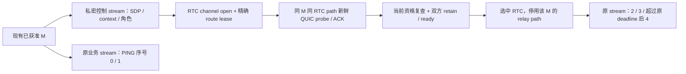

# Browser/native：原 relay M 的 RTC 路径

本次实现对应 [WebRTC 分步规划第 5 步](2026-10-03-browser-webrtc-replan.md#5-原-relay-m-换到-rtc)。双方已有已验证且持久化的成员材料，先用获准 relay 建立 Ordinary M，再为这条现有 QUIC Connection 增加 RTC 数据路径。材料交付、WSS 起步 M 的放行前转换，以及后续修复/业务/replica 验证仍属于各自步骤。

实施和资格证据见 [回执目录](../evidence/browser-rtc-relay-member-2026-10-04/README.md)。这是受控实验入口，不是默认 RTC 后端、TURN/STUN 服务或生产部署决定。

## 本次明确的实施选择

第一组已实现角色是 **browser 原 QUIC client / RTC offerer → native 原 QUIC server / RTC answerer**。两端显式检查这些角色和原 M 的 exporter/context binding；其它启动角色不在本次资格内。ICE 和 DTLS 角色从实际 stats 读取，不能由 offerer/answerer 推断。本次实际为 browser ICE controlling / DTLS server，native ICE controlled / DTLS client。

保留第 4 步的 native `webrtc 0.21.0` 驱动。每条 M 拥有一个持续 RTC association 和一个 datagram pump。通道使用 negotiated ID 0、unordered、`maxRetransmits=0`，独立的数据用途 label/protocol；读取两端实际属性和 SCTP `maxMessageSize`。完整 QUIC datagram 最大 2048 字节，发送/接收队列各限 64 KiB，registry 最多 32 个 association。实验未配置 STUN/TURN，候选对实际为非 relay。

`RtcRouteLease` 的路由属于具体原 Connection、attempt 和当前资格。独立 atomic revision 可在 Noq 锁内检查；资格变更另发 watch 通知，阻塞或空闲 pump 不靠轮询等待失效。资源退休和原 M 关闭也会唤醒 pump。共享 `RtcPumpGuard` 在每一种任务退出时退休精确 IO，并分别计数本 lease 和整个 transport 的活动任务。

额外的路径所有权、普通帧资格和选择条件，只适用于显式 `guards_application_data` 的 connection-bound RTC 载体。已有 custom 载体沿用原资源/用途规则、路径评分和终止发送错误语义；没有整体放开 custom。RTC 地址不能作为新 M 的 peer-wide bootstrap 路由，其他现有或新 M 也不能继承此 lease。

## 同一连接上的协调



在 DataChannel open 后由原 QUIC dialing side 调 Ordinary data-path 入口。未资格化 RTC 只允许路径验证/ACK 等帧；即使其它路径已关闭，也不能成为 STREAM/DATAGRAM fallback。接收侧在普通帧进入去重/ACK 状态前拒绝不合格报文，避免 ACK 已丢弃的 stream 内容。

`RtcPathProbe` 是绑定原 lease/path 的不可伪造本地对象；取得该次新鲜认证 ACK 并复查当前资格后才能 retain。回执记录两端各自的 path ID、probe watermark、发起/ACK 时刻以及 retain 前四项 STREAM/DATAGRAM 计数。双方确认后才选择 RTC；原 stream 和 TLS exporter binding 保持连续，不比较两端的本地 stable ID 是否相等。

建路沿一个 absolute caller deadline 读取剩余预算。正常 browser caller 为 12 秒，失败实验分别给 10 秒和 maintenance 的 2 秒；45 秒只是整次诊断上限。成功后的 association 属于原 M，其存续不由已结束的建路 deadline 控制。

## 失败与兼容边界

DataChannel 和真实 QUIC RTC path 建好后，丢弃随后新鲜 probe 的 QUIC datagram：不能报告换路，候选 lease/PC/pump 退休；旧 relay 仍获准时，原 M、原 stream 和并行业务调用继续可用。

独立审查发现并修复两个 pump 边界：native pump 退出必须立即退休 IO 并中止未完成协调；已经取出、正在等通道容量的报文，在资源/资格退休或原 M 关闭后不能再发送。共享 `while_active` 的取消有优先级，两端还在交给通道前复查当前 IO。

受影响的 member-relay 回归暴露了不能对旧 custom 载体套用新 RTC 评分/资格条件。固定前点同 case 通过、当前 case 失败、恢复旧载体评分语义后同 case 再通过，确认了此兼容差异；完整 14 个 member-relay 检查和 5 个 RTC lease/path 检查随后通过。没有修改原有 native congestion control 或产品超时。

## 复现和资格范围

```sh
rtk proxy python3 scripts/check_browser_paths.py --case relay-member-rtc --output /tmp/mio-rtc-s5
```

runner 使用自有正常证书 relay 和隔离 NSS trust，分别记录 native/WASM 编译、bindgen、源码前后 SHA-256 和实际构件 SHA-256。运行包括：原 stream 超过建路 caller deadline 后继续、已有第二 M 和新 M 保持 relay、丢弃 probe 时并行业务、2 秒 caller、native 新鲜 ACK 后实际 driver 故障，以及队列/任务/PC/socket 清理。未保存原 exporter、TLS key 或网络秘密。

Socket 回执是 `pc.close/drop` 后一次 scheduler yield 的即时进程快照：正常、2 秒和 pump 故障分别为 6→6；10 秒丢 probe 例为 6→13。随后在同一个仍运行的 native 进程中，下一个 short PC **构建之前**又观测到 6，证明这七个 socket 异步回收，不能把失败例描述成即时 6→6。没有记录精确回收延迟，也没有计数全部 webrtc 内部 driver task；本 lease/transport 的 bridge pump、队列和 association 退休有实际零计数。

这是同机 Chromium/Linux native 的真实 UDP/RTC/QUIC 资格；不是异网、公网 NAT、其它浏览器、native dialing side、WSS M hook、业务/非空 replica、完整资格变更产品矩阵或任意恢复流程的资格。后续第 6 步可复用 lease、IO、pump retirement、原路径 probe 和 revision 通知；必须另外实现并验证 Control hook 的版本/用途/最终放行边界。
