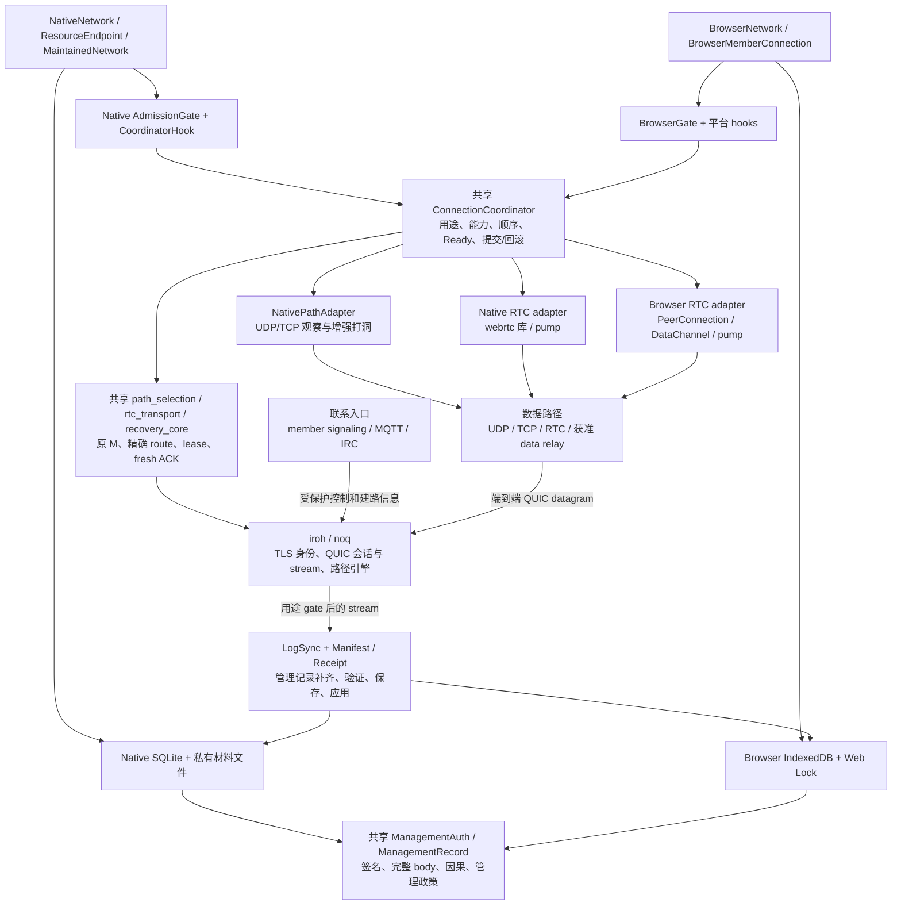
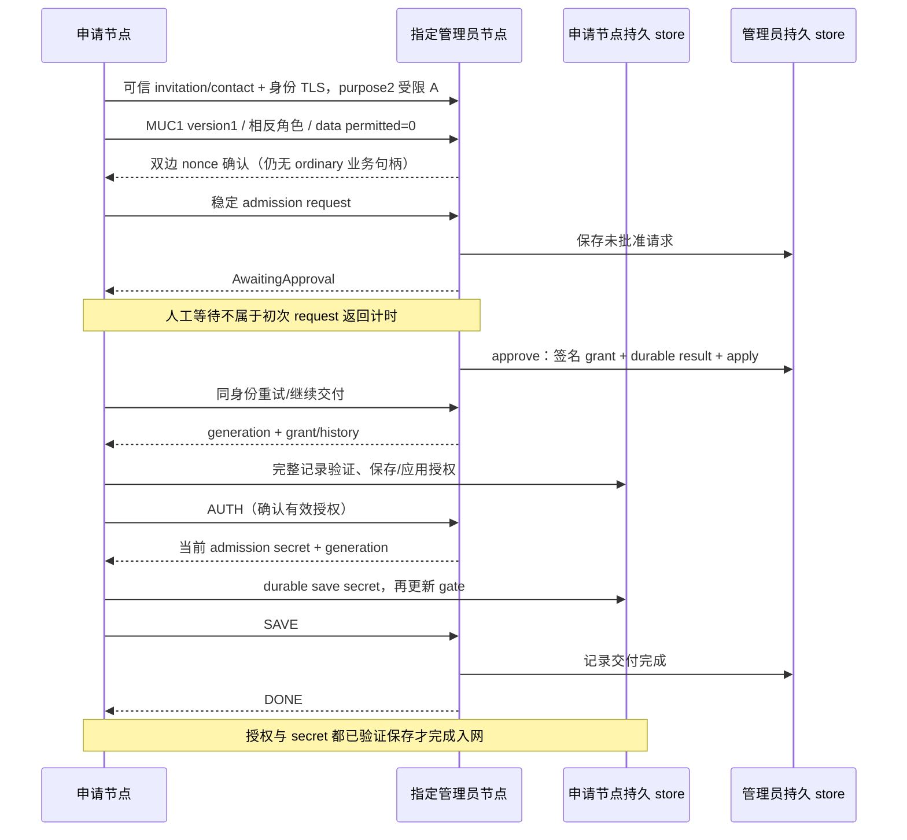
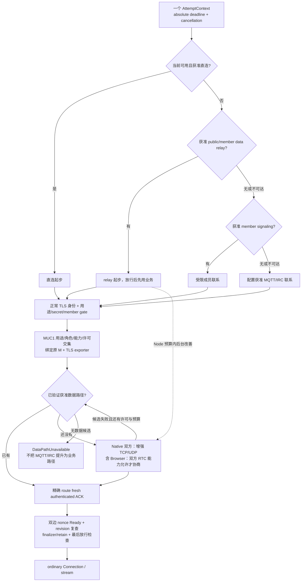
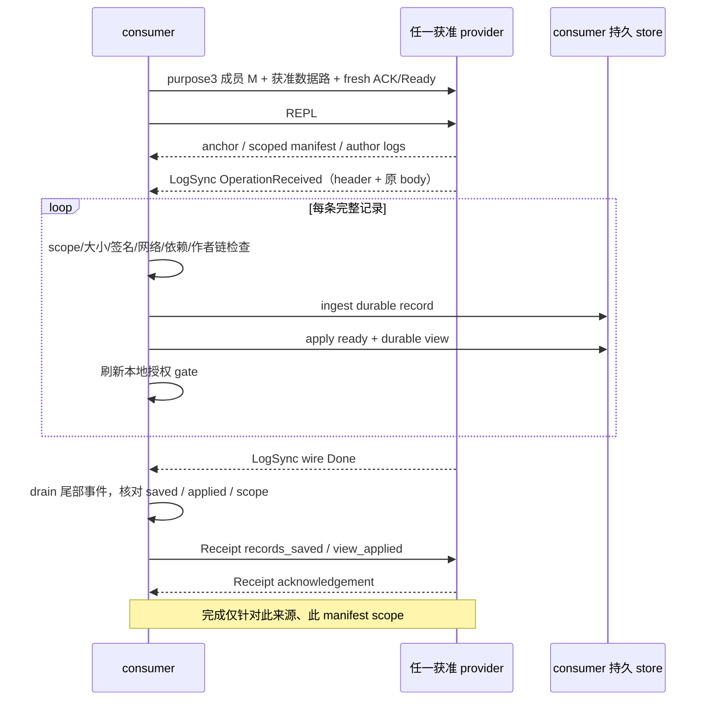

# 当前代码：架构、连接流程与性能证据地图

日期：2026-10-12。源码基线：`5beb2c79`；按当前工作区读取。本文是现状整理与维护导航，不是产品功能选择、重构批准、PRD 或新增验收要求。本轮只读取源码和既有一手回执，新增本报告；没有编译、运行测试、手机操作、修改网络或写入 Plane。

**当前实现已经形成“共享连接协调 + 平台适配 + 独立授权/持久化”的底座：入网申请保持受限，成员业务和管理副本须取得获准数据路径；原会话存活时可以改善或修复路径，终止后必须新连。** Native/WASM 已共用真正的协议代码，但节点接线、持久化和 RTC 驱动仍分别实现。性能证据主要是建连、管理副本和短消息延迟；目前不能据此判断持续吞吐、Android 后台、电量或完整平台表现。

最需要保留的边界：IRC 的受控确认合并实验约减少 **17.36%** 请求时间，公网最终受限请求约 **43.081 秒**；换 Wi-Fi 后的手机 MQTT/RTC 故事确实成功。这些分别有明确设施、构件和计时范围，不能合成一个通用性能结论。M84/M69 的完整方向/环境矩阵、默认 IRC profile 和全部 socket/task 终止资格仍未完成。

阅读依据是 [CONTEXT](../../CONTEXT.md)、[ADR 0009](../adr/0009-unified-session-and-capability-based-paths.md)、[统一实施设计](2026-10-05-unified-connection-architecture.md) 与十月源码/回执。README 原九月“无 active runtime”的文字已在本轮更新；ADR 当时“SDK 尚未统一实现”的阶段文字不代表当前源码仍不存在，旧 Go/OpenSpec 归档也不构成新实现的验收。依赖 fork 的文件改动、通用扩展及上游边界另见[修改审计](2026-10-12-iroh-p2panda-fork-change-audit.md)。

## 1. 模块地图与实际入口

图中的箭头表示职责/调用关系，不表示 MQTT/IRC 能承载获准普通业务。业务路径仍由 iroh/noq 承载原端到端 QUIC；RTC DataChannel 是报文载体，RTC 库/浏览器拥有 ICE、DTLS、SCTP，统一协调器不实现这套协议栈。[Native 接线:720](../../src/native_network.rs#L720)、[Browser 接线:1850](../../browser-probe/src/network.rs#L1850)、[RTC transport:25](../../src/rtc_transport.rs#L25)

| 层 | 当前文件与入口 | 实际职责与边界 |
| --- | --- | --- |
| Native 节点 | [native_network.rs:152](../../src/native_network.rs#L152)、[resources.rs:550](../../src/resources.rs#L550)、[network_maintenance.rs:148](../../src/network_maintenance.rs#L148) | `NativeNetwork` 创建/加入/重开持久身份和管理材料；`ResourceEndpoint` 配置资源与共同 connect；`MaintainedNetwork` 拥有联系、同步和改善任务。CLI/Android shell 是接入层，不是另一个授权系统。 |
| Browser 节点 | [network.rs:1500](../../browser-probe/src/network.rs#L1500)、[member_connection.rs:530](../../browser-probe/src/member_connection.rs#L530)、[incoming.rs](../../browser-probe/src/incoming.rs) | `BrowserNetwork` 是独立身份的 WASM 节点，持有 store lease、carrier、gate 和 incoming dispatcher；成员 connect/accept 的普通句柄由 `BrowserMemberConnection` 包装。`lib.rs` 的简易 `BrowserNode` ping 是 probe，不能替代完整成员入口。 |
| 共同连接核心 | [connection_coordinator.rs:96](../../src/connection_coordinator.rs#L96)、[connection_coordinator.rs:618](../../src/connection_coordinator.rs#L618) | 用途、严格 MUC1、新连接尝试、能力/许可交集、候选准备、fresh ACK、双边 nonce Ready、revision 复查、retain/rollback；已有 M 的 MIA1 改善使用同一核心。 |
| 平台 hook/adapter | [connection_coordinator_native.rs:508](../../src/connection_coordinator_native.rs#L508)、[network.rs:1129](../../browser-probe/src/network.rs#L1129)、[native_path_adapter.rs:53](../../src/native_path_adapter.rs#L53)、两侧 `rtc_member.rs` | Native 接 AdmissionGate、NatConnector、TCP 与 native RTC；Browser 接 durable snapshot、实际能力探测、JS RTC。共同规则已共享，平台 I/O/对象所有权和 gate 接线仍分开。 |
| 授权与记录 | [management_auth.rs:90](../../src/management_auth.rs#L90)、[management_record.rs:3](../../src/management_record.rs#L3)、[admission_gate.rs:403](../../src/admission_gate.rs#L403) | 完整签名 header/body、网络 anchor、因果依赖、作者 log/backlink、管理动作政策和本地授权视图；秘密证明不等于成员资格，路径连通也不授予业务权限。 |
| 平台持久化 | [management_store.rs:106](../../src/management_store.rs#L106)、[native_network.rs:1096](../../src/native_network.rs#L1096)、[storage.js:7](../../browser-probe/src/storage.js#L7) | Native 为单连接 SQLite WAL/FULL + fsync/原子发布私有材料；Browser 为独占 Web Lock + IndexedDB strict 事务完成后确认保存。二者共享验证语义，不能把存储实现视为相同。 |
| 管理副本 | [offline_replica.rs:179](../../src/offline_replica.rs#L179)、[replica.rs:204](../../browser-probe/src/replica.rs#L204)、[replica_snapshot.rs](../../src/replica_snapshot.rs) | 实际 p2panda LogSync，完整记录 consumer、manifest scope 和双方 receipt；同步的是管理历史，不是任意业务文件或文档。 |
| 资源/维护 | [resources.rs:251](../../src/resources.rs#L251)、[network_maintenance.rs:48](../../src/network_maintenance.rs#L48)、[contact_listener.rs](../../src/contact_listener.rs)、[session_maintenance.rs:39](../../src/session_maintenance.rs#L39) | 观察、信令、data relay 分用途许可；Node 预算/退避与 listener 生命周期；每个原 M 只占一个改善 lease，weak 引用不把业务连接强行保活。 |

### 真正共享了什么，p2panda 用到了哪一层

Browser 直接用 `#[path = "../../src/…"]` 编译同一份源码：connection budget/coordinator/recovery core、admission proof、management auth/record/action、admission request ID、precode policy、path selection、session maintenance、MQTT/IRC datagram、replica snapshot，以及 RTC association/ICE profile/transport/wire。它还引用 vendor `p2panda-net` 的 codec。不是复制两份同名连接状态机。[browser lib:1](../../browser-probe/src/lib.rs#L1)、[browser lib:122](../../browser-probe/src/lib.rs#L122)

p2panda 的复用是有选择的：core 的 key/header/hash/CBOR 与完整 operation 验证；auth 的 GroupCrdt/StrongRemove 和 `process_checked`，外加本项目管理政策；sync 的真实 LogSync；net 的 codec、地址信息与 sampling/random walker；store 的 SQLite address-book store 供 Native peer sampler 使用。Native 管理数据库本身是本项目 `ManagementStore` 的 SQLx schema，不是把所有管理状态交给 p2panda 高层 Node。[auth:9](../../src/management_auth.rs#L9)、[auth:122](../../src/management_auth.rs#L122)、[replica:11](../../src/offline_replica.rs#L11)、[peer sampler:308](../../src/network_maintenance.rs#L308)

当前 `src/` 与 `browser-probe/src/` 未见使用 p2panda 高层 `Node`/`NodeBuilder` 的正式节点链；`src/main.rs` 的独立基础 probe 用过 `p2panda_net::Endpoint`/IrohConfig，而 NativeNetwork 与 BrowserNetwork 直接组合 iroh endpoint、项目 gate/coordinator 和上述局部组件。不要把依赖目录提供的上层 API 都算成当前产品已经采用。[main:21](../../src/main.rs#L21)、[Native builder:750](../../src/native_network.rs#L750)、[Browser builder:1873](../../browser-probe/src/network.rs#L1873)

### 保留的 formal NAT 实验链与当前 SDK

`udp_nat_probe::run_formal` 仍先以自己的 ALPN 建 MQTT `ControlSession`，验证预期 peer/member gate，创建 NatConnector，`upgrade` 后做 NAT_DATA/NAT_ACK 和 winner/score 观察。它是特定 NAT 纵切实验入口。[probe:1883](../../src/bin/udp_nat_probe.rs#L1883)

当前 SDK 的成员入口先进入共同 connect/accept 和用途 hooks，再由 `CoordinatorHook` 调 `NativePathAdapter`，后者继续复用 `NatConnector::prepare_upgrade`、有序 QAD/STUN 观察、direct/selector/executor 与 TCP punch，产出绑定原 M 的 `PreparedPath`。因此旧算法实现并未被随统一协调全部丢弃；但旧 probe 的成功不能充当新版 MUC1/SDK/全平台资格。增强 native 的当前适配顺序是 TCP 先尝试、失败后 UDP，受既有许可/预算和外层 deadline 限制。[native adapter:53](../../src/native_path_adapter.rs#L53)、[native adapter:115](../../src/native_path_adapter.rs#L115)、[Nat observe:165](../../src/nat_connection.rs#L165)

## 2. 生命周期与连接顺序

### 启动/重开：先重建可信状态，再接通信

Native 的创建会保存节点身份/anchor、签名 Create、准入秘密并应用管理视图；重开读取固定节点 key 与 anchor，核对 invitation 或 genesis credential，打开管理 store，先 `apply_ready` 和恢复 rotation material，再建立 gate。Configured bind 随后验证资源许可、安装允许的 adapter、gate 和 coordinator，绑定同一持久 key，等待联系入口 readiness。进入 `maintain_network…` 才由维护 owner 创建 Router、peer sampler、listener 和同步/改善循环。[Native create:152](../../src/native_network.rs#L152)、[reopen:376](../../src/native_network.rs#L376)、[hook 接线:736](../../src/native_network.rs#L736)、[maintenance:1258](../../src/network_maintenance.rs#L1258)

Browser `start` 在 timer/I/O 前验证输入 maintenance policy；取得 Web Lock，读取/验证 IndexedDB SavedNode，合并实际资源配置，探测本次 RTC 所需能力，并保存配置快照。之后安装 BrowserGate、允许的 relay/MQTT/IRC/member data/RTC carrier 与 selector，至少一个 carrier ready 后启动 incoming dispatcher。能力探测失败或被禁止不提供 RTC 候选；API 可用也不证明网络可达。关闭后重开重新验证保存材料和本次能力，不复活旧 M/lease。[start:1580](../../browser-probe/src/network.rs#L1580)、[capability:55](../../browser-probe/src/rtc_capability.rs#L55)、[install:1833](../../browser-probe/src/network.rs#L1833)、[ready:1979](../../browser-probe/src/network.rs#L1979)

### 受限申请 → 审批 → 交付保存

AdmissionRequest 和 precode 对应同一 purpose2，但 ALPN 区分 handler；`coordinate_session` 将双方 data permit 置零，仅完成能力/身份上下文和 nonce 确认，不准备业务路径。precode 的次数/指定 redemption 节点与 manual approval 的持久结果仍由各自 handler/store 管理。[purpose:111](../../src/connection_coordinator.rs#L111)、[restricted:950](../../src/connection_coordinator.rs#L950)、[approve:222](../../src/manual_admission.rs#L222)

交付严格先验证 history 中的授权及管理员，再持久保存授权；AUTH 后接收匹配 generation 的 secret，durable save 后才发 SAVE。Native 私有文件发布与 DB pin、Browser IndexedDB `oncomplete` 是对应保存边界。审批成功但保存未完整时仍是 pending completion；中断保留已保存材料，不能把 approve 等同于入网完成，也不能通过另一条 ordinary 会话绕过材料条件。[Native history:563](../../src/manual_admission.rs#L563)、[Native completion:631](../../src/manual_admission.rs#L631)、[Native save:1096](../../src/native_network.rs#L1096)、[Browser completion:2233](../../browser-probe/src/network.rs#L2233)、[Browser commit:2355](../../browser-probe/src/network.rs#L2355)

### 普通 connect/accept：联系顺序、同一个 M 与放行门槛

实现中的“当前可用直连”有具体含义：外层 connect 优先缓存里 `Active` 的 IP，再尝试 relay/member-data route；member signaling 先于配置公共联系；未验证/未 active 的 IP hint 在联系候选之后兜底，冷启动只有 IP 时仍直接尝试。仅 QUIC setup 的可达性错误允许继续换联系；已认证 M 上的权限、受保护控制或数据错误不会伪装成新的入网尝试。[dial 错误:602](../../src/connection_coordinator.rs#L602)、[route 顺序:649](../../src/connection_coordinator.rs#L649)

ALPN 和 purpose 不一致在 accept 的候选准备前拒绝。MemberBusiness=1、AdmissionRequest=2、Replica=3、ActiveImprovement=4；恢复用途仍有单独权限，不能当普通 Replica 降级。TLS 识别 peer 之后，Native gate 完成当前 secret proof、成员/本地成员检查；共同协议检查严格版本、用途、相反角色、runtime supported/permitted 和 nonce。[accept:792](../../src/connection_coordinator.rs#L792)、[gate:639](../../src/admission_gate.rs#L639)、[MUC1:851](../../src/connection_coordinator.rs#L851)

共同 candidate 不是“DataChannel open 就算完成”：须精确 original M/route/path 的 fresh authenticated ACK、双边 Ready、授权 revision 和 finalizer 检查通过才能返回普通句柄。初次 RTC 适配器先完成 initial qualification/Control seal，最后 `with_retain` 再取 final probe 与交接 owner；Active M 的改善使用 validation-only candidate，不能照搬初次提前 qualification。这里没有逐流 private-only permit；边界是初次 hook 完成前不暴露 ordinary handle。[fresh probe:1023](../../src/connection_coordinator.rs#L1023)、[final checks:1058](../../src/connection_coordinator.rs#L1058)、[Browser RTC finalizer:568](../../browser-probe/src/rtc_member.rs#L568)、[实施边界](2026-10-05-unified-connection-architecture.md)

所有阶段消费同一个 caller deadline 剩余时间，不逐阶段重置。当前默认整次建路预算为 60 秒，显式短预算仍有效，显式 caller/maintenance 上限为 300 秒；setup deadline 不负责退休已经成功归 M 所有的路径。不要把这些内部预算值变成未来普通用户必须填写的产品参数。[budget](../../src/connection_budget.rs)、[AttemptContext:444](../../src/connection_coordinator.rs#L444)、[预算与 listener 记录](2026-10-11-irc-budget-and-node-listener-lifetime.md)

### 同会话改善/修复，与终止后新连接

维护 owner 在 Node 预算中挑 live M；共享 SessionMaintenance 用 weak original + epoch 占一个 M 的改善 lease。另建受限控制 C，MIA1 hello 带原 TLS exporter binding，双边确认 control peer、原 binding、当前权限和 revision；控制的发起方向决定 RTC offer/answer，原 M 的 QUIC dialer 独立决定谁 `open_data_transport_path`。候选 ACK/Ready/Committed 与 retain 成功后交给原 M；失败退休候选，健康当前路径和旧 stream 继续。[maintenance:848](../../src/network_maintenance.rs#L848)、[session lease:100](../../src/session_maintenance.rs#L100)、[active binding:1363](../../src/connection_coordinator.rs#L1363)、[active commit:1470](../../src/connection_coordinator.rs#L1470)

显式 repair 的预算是 caller 剩余时间与既有 3 秒 repair cap 的较小值；原 M 已 closed 则返回 Terminal，尚存则可返回 Retryable。后来 `connect` 创建新 M，旧 stream 不称为恢复。Quality 默认按实际 RTT，保留 5ms 防抖；RTC 精确验证路线被归为 Direct，member data relay 归为 Relay，显式 PreferDirect/PreferRelay 是可选偏好，不能推断 direct 永远最快。[repair:97](../../src/connection_coordinator_native.rs#L97)、[terminal:18](../../src/connection_recovery_core.rs#L18)、[selector:123](../../src/path_selection.rs#L123)

### 管理副本：收齐 wire 之后还有保存/应用/回执

Native consumer 到达事件即保存，wire 中断也不抛弃已提交记录；缺依赖或作者前序的记录等待后续 `apply_ready`。SQLite 同一事务保存 applied_order 与 view，再替换内存授权；Browser merge/replay 完整记录后整份 SavedNode commit，事务完成才更新 gate。没有验证完整 body 的 header 不能入授权图。[auth:339](../../src/management_auth.rs#L339)、[store ingest:524](../../src/management_store.rs#L524)、[store apply:550](../../src/management_store.rs#L550)、[Browser ingest:188](../../browser-probe/src/replica.rs#L188)

本项目 consumer 从空 LogSync snapshot 请求源 scope，避免本地 pending/incomplete 记录让一次交换误称完成；这是有界完整性路线，不能凭名字断言现已具备最省带宽的增量同步。原协议 Done 后还要 drain、保存/应用核对与双方 receipt；首次 foreground sync 同时受原 caller 剩余时间和 operation ceiling 约束。离线节点后来可向保留管理历史的其他获准成员补齐，来源完成不等于全网最新；作者不必重新上线。[consumer:203](../../src/offline_replica.rs#L203)、[receipt:238](../../src/offline_replica.rs#L238)、[provider:380](../../src/offline_replica.rs#L380)、[Browser receipt:255](../../browser-probe/src/replica.rs#L255)

### 取消、撤销、资源禁用与 close

| 触发 | 源码中的处理 | 必须分开的结果 |
| --- | --- | --- |
| 未完成 connect 取消/到 deadline | AttemptContext + PendingMember guard 关闭本次 pending M，candidate rollback | 不修改 durable 成员材料；与已持有的另一条健康 M 不同。[guard:822](../../src/connection_coordinator.rs#L822) |
| 已有 M 的改善取消/失败 | lease 释放本次 reservation/Node guard；受限 C 结束、候选退休 | 不因取消改善关闭健康业务 M；授权已失效时不能以保留路径为理由继续业务。[lease:159](../../src/session_maintenance.rs#L159)、[control:70](../../src/connection_coordinator_native.rs#L70) |
| 本地验证到成员撤销/secret rotation | authorization epoch/revision 失效，移除受影响 sessions；session owner 回收其通信 | 新连接拒绝、现有通信终止是本地已知记录的效应；不宣称未获记录的节点瞬时同步。[gate:341](../../src/admission_gate.rs#L341) |
| 联系/RTC/资源禁用 | 撤回 listener 可用声明与 route，退休相关资格/对象；只保留其他仍获准资源 | 联系入口故障不等于成员资格失效；配置禁用不能用“需要连通”自动覆盖。[disable:239](../../src/network_maintenance.rs#L239)、[RTC revision:467](../../src/rtc_transport.rs#L467) |
| Node close | Native cancel 并等待 owner，shutdown listener/Router、关闭 store；Browser 清 delivery/management/member-data，停 dispatcher、close endpoint、释放 store lease | `close` 返回、socket 进入 CLOSING、实际 close event、全部异步终态任务退出是不同观测。[Native close:274](../../src/network_maintenance.rs#L274)、[owner stop:1163](../../src/network_maintenance.rs#L1163)、[Browser close:2318](../../browser-probe/src/network.rs#L2318) |

## 3. 性能事实表：测量边界优先于数字

下表只摘录已有公开回执；不同设施、日期、构件、scope 不做同条件排名。人工审批、重开、验证及清理是否计入，按每一行的边界解释。

| 已执行范围 | 数值与实际切点 | 说明/不能外推 | 一手来源 |
| --- | --- | --- | --- |
| M89 公网 Base64 基线 → CID2/确认合并 | 基线60.488/59.986s；仅CID2 35.400/48.080/48.105s；最终合并43.081s，相对基线平均约减少28.5% | 初次 purpose2 请求至 AwaitingApproval，尚未计后续普通成员建路。仅CID与合并公网范围重叠，不能独立隔离合并收益；显式60s caller/attempt、assembly8s、queue30s、fallback600ms且实际SAFERATE，**完整默认profile未认证** | [public cohorts](../evidence/irc-cid-confirmation-2026-10-11/public-cohorts.json)、[final story](../evidence/irc-cid-confirmation-2026-10-11/final-public-story.json) |
| M89 自有慢 IRC ABBA 对照 | 29.139 / 24.109 / 23.640 / 28.642s；CID-only平均28.891s，合并平均23.875s，少5.016s，**17.3623%** | 固定同一设施、CID2、profile；两次/实现。此组caller/attempt为120s、pacing10ms、assembly8s、queue30s；确认合并的窄受控增益，不能叠加至公网或保证任意服务 | [controlled-confirmation-pairs.json](../evidence/irc-cid-confirmation-2026-10-11/controlled-confirmation-pairs.json) |
| 10/06 Host Browser→Pixel Browser，公共 MQTT/RTC | connect/accept至普通句柄6.867/7.034s | 已有成员材料；业务另验；未排除 overlay，非最终SDK同条件性能重跑 | [closeout comparison](../evidence/connection-mainline-closeout-2026-10-11.json) |
| 10/07 Host Browser/Native，APS1 relay 后改善 RTC | relay普通句柄6.711s；后续improve 7.874s；两个调用合计14.585s | relay先实际业务；同机RTC候选；合计不是连续wall-clock、不含首次人工审批；原证据socket/task终态不完整 | [closeout comparison](../evidence/connection-mainline-closeout-2026-10-11.json) |
| 10/11 当前有限代表用例 | 两浏览器正向10.949/11.088s，反向8.322/8.308s；同机relay open242.480ms，improve716.750ms；唯一RTC carrier故障后repair576.620ms | 各用例设施不同；修复保留原M/binding/stream，非真实换网性能。RTC无路实际等待60.003s而原relay业务仍正常；首次12s失败原因仍未知 | [current mainline dossier](../evidence/current-connection-mainline-2026-10-11/README.md) |
| 10/11 OP13 cellular Native + Pixel新Wi-Fi Browser，公共 MQTT/RTC | member caller **7857.570ms**；非空Replica **8579.680ms**；PING/PONG **44.510ms**；整轮 **74103.828ms** | 同一固定构件，4条管理记录保存/应用并重开；ordinary RTC，无data relay/TURN。整轮包含审批、负例和清理；用户换网后新故事成功，不是持续旧stream无损切Wi-Fi实验 | [Wi-Fi retest](../evidence/rtc-switched-wifi-retest-2026-10-11/README.md)、[summary](../evidence/rtc-switched-wifi-retest-2026-10-11/summary.json) |
| 10/05 Native↔Native，持久身份loopback UDP纵切 | 共同SDK成功caller405ms，cleanup4ms，另有117ms晚期socket观察 | 是当时构件/loopback窄例；不当作当前公网或Android建连性能基准 | [unified-native receipt](../evidence/unified-native-2026-10-05/receipt.json) |

IRC 的三个改动阶段各解决不同问题。M87 将正式 listener 寿命与单次 attempt 分开，允许显式较长预算/queue；最终旧 hex 构件在公网完整请求为228.690s，条件是caller300s、pacing600ms、assembly8s、queue30s，没有认证60s默认。[M87 原回执](../evidence/mio87-irc-budget-lifetime-2026-10-11/README.md)

M88 采用 MIR2 Base64，在实际252B片容量下将1200B datagram从10片减为5片，完整行最大509B。只取消SAFERATE下额外固定等待的首轮268.033s反而较慢；修正额外 Control 质量PING后，最终完整请求60.488s。该次caller仍300s，不能把总收益全部归于Base64，也不能说所有服务相同容量。[M88 原回执](../evidence/irc-base64-saferate-2026-10-11/README.md)

M88 跳过 Control 的额外质量维护 PING，保留 Ordinary 路径探测及 QUIC 自身心跳/拥塞/重传；M89 CID 自动缩为2仅覆盖明确独占 IRC 配置，其他默认仍5，八并发路径槽位保留。受限请求合并一字节阶段接受与统一确认后，应用流之前由两个控制stream减为一个。它们是已落地的实现改动，不是新增 QUIC 拥塞算法或任意公共 IRC 延迟承诺。[M88 实施](2026-10-11-irc-base64-saferate-implementation.md)、[M89 实施](2026-10-11-irc-cid-and-confirmation.md)

尚无可据上述当前故事推导的持续大流量吞吐、p95/p99、多并发、长期空闲CPU/RSS、Android后台/功耗、UI内存数据。既有 formal NAT 比较确实留过每节点 CPU/RSS/FD/packet 计数，但其 generation1/2/3、kernel fixture 和采样边界各自固定；它们是实验成本证据，不是当前共同SDK跨平台benchmark。无需用构建耗时、capture packet数或单次PING换算业务吞吐。[formal costs 导航](../evidence/mio60-formal-nat/README.md)、[UI性能尚未测](2026-10-03-shared-web-client-ui-direction.md)

## 4. 复杂度热点与整理候选

以下为当前物理源码行数，包含空行、注释、inline test/fixture；只是阅读成本线索，不是 bug 数或应删代码量。整理建议仅是维护候选，本报告不启动拆分、改变模块API或移动协议。

| 热点 | 行数 | 维护负担与候选方向 |
| --- | ---: | --- |
| Browser `network.rs` | 2615 | SavedNode/config、gate/hooks、startup、admission交付与connect接线集中。可先建立入口→hook→存储索引，未来再评估按现有职责拆文件，避免产生第二套协议核心。 |
| 共享 `connection_coordinator.rs` | 1730 | 初次MUC1和active MIA1、wire验证、候选提交/回滚与fixtures同处。维护时区分 initial与active状态，保留原M/控制C/attempt三个身份，避免只按函数长度拆散不变量。 |
| Native `network_maintenance.rs` / `native_network.rs` / `resources.rs` | 1433 / 1371 / 1200 | Node owner、持久化恢复、资源配置与hook安装横向关联。优先记录所有权/启动失败/close顺序及配置许可传递，不增并行重连/质量循环。 |
| `rtc_transport.rs` | 1293 | 共享 exact-route lease、qualification、queue/pump与诊断fixture。候选是清晰导航生产边界/fixture边界；queue/lease一旦按粗粒度peer重组就容易跨M串用。 |
| Native/Browser `rtc_member.rs` | 1103 / 1091 | 同一准备/initial/final-retain概念，两套平台对象与pump。可对照共用的PreparedPath/lease约定列接线表；并非所有重复都值得抽象，JS事件与Native任务所有权不同。 |
| `management_store.rs` / `admission_gate.rs` | 861 / 783 | record ingest/apply、durable授权与ephemeral gate联动。可先文档化commit→view→revision顺序；不能为简化把批准、保存secret和普通放行压成一个状态。 |
| probe binaries（如`udp_nat_probe.rs`） | 2212 | 大量历史对照/诊断、实验selector和CLI，不属于共享SDK状态机。阅读和统计须与runtime层分开；不据文件大就移除既有证据入口。 |

同样可先把“当前SDK正式入口、窄fixture、历史probe、构件回执”索引分清，降低把旧成功外推到新版协议的风险。Native 与 Browser 的复制consumer也有相同LogSync/drain/receipt逻辑，但存储接口不同；在没有新行为改动的整理轮次中，表述这一接缝比立即做大泛型重构更可审查。[Native consumer](../../src/offline_replica.rs#L179)、[Browser consumer](../../browser-probe/src/replica.rs#L204)

这些内部复杂度不是未来UI字段列表。已有少配置、自配置方向保持有效：用户表达可信网络、授权对象与资源许可，软件负责能力探测、建路、退避、budget与同步编排。本报告列内部参数为工程解释，没有决定默认公共服务、框架或首项业务功能。[已确认易用性取向](2026-10-03-shared-web-client-ui-direction.md)

## 5. 已测、代码存在与未验证的边界

| Scope | 已有实测/源码事实 | 仍不能声称 |
| --- | --- | --- |
| 当前代表连接流程 | 公共relay无RTC、两浏览器双向MQTT/RTC、同机relay改善/真实carrier repair、RTC无路和Native联系入口回退 | 当前所有平台组合、双向、物理公网无overlay全矩阵已完成；首次12s失败已定位。[M84有限审计](../evidence/current-connection-mainline-2026-10-11/README.md) |
| 手机异网RTC | OP13 cellular↔Pixel新Wi-Fi故事，ordinary selected RTC、4条Replica、身份材料重开、未批准/撤销负例；collector有physical/WAN限定资格 | 所有socket UID/protect事实已知，collector独立验证MESSAGE-INTEGRITY，所有方向/NAT环境或长期切网都通过。[route-proof](../evidence/rtc-switched-wifi-retest-2026-10-11/route-proof.json) |
| IRC | 当前purpose2请求、真实审批交付/重开、之后获准relay成员业务、最终公开/owned自然WSS close event | IRC承载普通业务、完整默认profile认证、对任意公共服务延迟保证；其自然关闭可覆盖其他carrier清理缺口。[M89 evidence](../evidence/irc-cid-confirmation-2026-10-11/README.md) |
| 管理功能 | manual/precode、日常管理、genesis恢复、rotation、migration均有源码与各自历史验证笔记 | 当前物理故事测试所有管理分支、Browser创建网络/创世恢复已完整交付、任意业务数据同步已存在。当前最完整手机故事只证明其实际选定scope。 |
| 生命周期 | exactM lease/retirement和Node close有代码；各故事scope内PC/DC/pump/listener/拥有进程清理有回执 | 全部SDK terminal socket/task已自然退休。当前relay/MQTT仍有CLOSING尾部、`allSdkTerminalTasksRetiredProven=false`；Wi-Fi repeat Native immediate/100ms仍4 sockets。[当前清理边界](../evidence/current-connection-mainline-2026-10-11/README.md)、[手机清理边界](../evidence/rtc-switched-wifi-retest-2026-10-11/README.md) |
| 性能与产品交付 | 已有具体建连/Replica/PING测量与IRC窄受控比较；CLI/WASM SDK可实跑 | 持续带宽、CPU/电量/后台/UI已验收，通用VPN/文件工具/透明服务入口已实现，或者全量无bug。 |

M69/M84 的完整矩阵、默认profile、故障覆盖和socket/task终止仍按既有Plane记录保持开放。本报告不重开历史切片，不创建新任务，也不把“整理候选”升级为设计决定。

## 6. 后续阅读导航

- **整体修改边界**：[iroh/p2panda fork 修改审计](2026-10-12-iroh-p2panda-fork-change-audit.md)；依赖与patch入口为[Cargo.toml](../../Cargo.toml)。
- **会话与路径不变量**：[ADR 0009](../adr/0009-unified-session-and-capability-based-paths.md)、[共同实施设计](2026-10-05-unified-connection-architecture.md)、[原会话维护](2026-10-02-connection-path-maintenance.md)。
- **授权与持久化**：[签名管理权限ADR](../adr/0007-signed-management-authority-mapping.md)、[入网完成](2026-10-01-admission-completion-validation.md)、[离线副本](2026-10-01-offline-replica-validation.md)。
- **最新运行/限制**：[连接主线收尾](2026-10-11-connection-mainline-closeout.md)、[M84当前有限验证](../evidence/current-connection-mainline-2026-10-11/README.md)、[Wi-Fi RTC复测](../evidence/rtc-switched-wifi-retest-2026-10-11/README.md)。
- **IRC具体收益**：[M87预算/listener](2026-10-11-irc-budget-and-node-listener-lifetime.md)、[M88编码/Control探测](2026-10-11-irc-base64-saferate-implementation.md)、[M89 CID/确认](2026-10-11-irc-cid-and-confirmation.md)。

源码行号对应本文读取的当前基线；以后文件移动时应重新定位符号，而不是把旧行号视为固定接口。既有WIP和历史证据保持原样。
